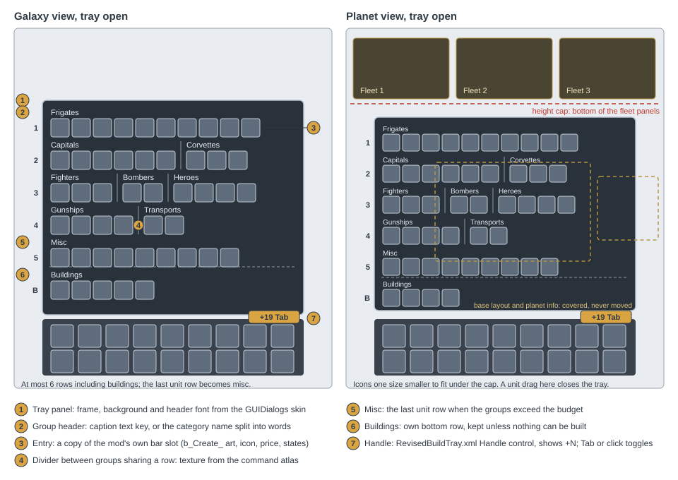

# Galactic build tray

Status: **specified, not implemented** (legacy EAWR-7830). Every rule below is settled; the
build order is in [the implementation plan](galactic-build-tray-plan.md). The owner decided
the direction, the planet view overlay, the row budget, the open and close rules, Tab, the
Tweaks switch and the compat patch model. The technical details (element names, the category
priority list, the building categories list) follow from the data checks recorded in GBT-04
and GBT-05.

## Problem

The galactic build bar has two rows of fixed slots. Large mods offer more choices at one
planet than fit, and the original game simply omits the overflow: there is no paging and the
scroll controls stay hidden ([GHUD-S92](../behaviour/gc-hud-inventory.md#galactic-build-row-placement)).
Mods work around this with their own filter buttons. Horizontal scrolling would work but hides
most of the roster and looks out of place.

## Goals

- The bar's cards look and behave exactly like the original game, also when everything fits: the tray only adds a
  handle above them. The one visible change on a planet where everything fits: a production queue strip that would
  sit under the always-shown handle moves up to clear it (GBT-14).
- When it doesn't, every choice is reachable in one click, without scrolling or paging.
- Works with existing mods unchanged. It only uses game data every mod already has; a mod
  needs no new tag in its object XML.
- Never resizes, hides or restyles an existing UI element, and moves none but the production queue strips (GBT-14),
  and only to clear the handle or the open tray. Mods put a lot of work into their HUDs; the handle and the tray
  draw on top of them.
- Mod UI agnostic: the tray is built from UI parts the mod already has (GBT-10), so it takes on
  the mod's look without the mod doing anything.
- All layout lives in Revised layer XML (GBT-11), like the planet search and the project HUD
  layer. Disabling Revised removes the tray and leaves the original bar.
- A mod's own filter buttons keep working: the tray shows whatever list the bar is given.
- Behind an Options > Tweaks switch, on by default, like the other project additions
  (GBT-13).

Not a goal: changing the bar itself (slot count, size, `GUI_Row` behaviour).

## Layout



A schematic, not final art: every part takes its look from the mod's own UI (GBT-10), so the
tray looks like a stock tray in stock and like a Remake tray in Remake. The numbers match the
parts in GBT-10 and the rules in GBT-02, GBT-04 and GBT-06. Sizes and gaps come from the
layout file (GBT-11).

## Terms

- **Bar**: the original two-row production component set (`b_Create_` slots).
- **Choice list**: the current build choices for the selected planet and the active space or
  ground tab, as the bar computes them (WGUI-91, GHUD-S90).
- **Tray**: the panel this spec adds. It grows upward from the bar.
- **Handle**: the control that opens and closes the tray.

## GBT-01 The bar is unchanged

The bar keeps the original rules: `GUI_Row` places choices in its two rows, each row fills in
type-manager order, and choices beyond a row's slots are omitted (GHUD-S90 to GHUD-S92).
The tray never repurposes a bar slot.

## GBT-02 Handle

- The handle is always shown for a planet the local player owns whose selected tab has build choices
  (owner decision of 2026-11-19: the tray is always available, and the handle is the way in for a
  player who does not use the hotkey). It does not depend on whether the bar omits anything.
- It reads `+N`, where N is the number of choices the bar omits. When the bar omits none it keeps its
  art and its caption but shows no count: the caption alone (`+`).
- It is a project control, not one of the mod's slots: the `Handle` control in
  `RevisedBuildTray.xml` (GBT-11). It is placed with ordered `Candidate` positions, using the
  same anchor, side and offset rules as the project HUD layer's Gift control
  ([project HUD layer](project-hud-layer.md)). The default candidate is on the top edge of the
  bar.
- The Revised layer or a mod can restyle it, move it, or disable it. Disabling the handle
  disables the tray.
- Clicking it opens the tray; clicking it again closes it.

## GBT-03 Tray contents

- The tray shows the **full** choice list, grouped, not only the omitted choices. The bar stays
  visible and usable below it.
- A tray entry behaves exactly like the bar button for the same choice: same icon, price,
  tooltip, enabled or disabled state (including "already under production"), and the same
  click actions.
- The tray never scrolls.

## GBT-04 Buildings group

- A choice is a **building** when the engine treats it as a structure or base: a ground special
  structure (uses a land slot), an orbital special structure (uses a space slot), a star base
  level or a ground base level (WGEP-23, WGEP-24, WGEP-158, WGEP-159). These roles come from
  the type's `Behavior` tags, so they work for any mod.
- The `Build_Tab_*` flags, the XML element name and the encyclopedia class text are **not**
  used. Stock sets `Build_Tab_Special_Structures` on some space units, several mods put
  structures under `Build_Tab_Space_Units`, and mods invent their own element names
  (tag coverage data, `docs/tag-coverage/coverage-universe.json`).
- All buildings form one group, on their own row at the bottom of the tray.
- The buildings row is always shown, unless no building can be built at that planet right now
  (all slots full, all built, limits reached). Because the tray only lists current choices, the
  row then has no entries and is hidden. A star base upgrade alone keeps the row: star base
  levels do not use special structure slots (WGEP-23, WGEP-24).
- Checked on stock, Remake 4.0 and Thrawn's Revenge (legacy EAWR-7834): the gravity well station is
  an orbital structure in all three, and every structure or base those mods offer carries one
  of the four roles. Thrawn's Revenge puts 115 of its buildings under `Build_Tab_Space_Units`,
  which confirms the build tab flags cannot be used. Counts of buildings by role: stock 62
  ground structures, 17 star bases, 16 ground bases, 8 orbital structures; Remake 4.0
  551 / 59 / 48 / 180; Thrawn's Revenge 390 / 94 / 16 / 127.
- **Economy buildings sold as units.** Remake 4.0 sells its administration offices, mining
  facilities and similar as ground companies. A company carries no category of its own: its
  categories are its members' (GBT-05), and the member of such a company is a dummy vehicle whose
  only category is `Structure` (194 choices, per terrain), with no structure role. So a choice
  also counts as a building when its category (GBT-05) is in the groups file's **building
  categories list**, default `Structure` and `SpaceStructure` (GBT-12). The data check
  (legacy EAWR-7833) found the gap in Remake 4.0 only, so the list is not needed for stock or Thrawn's
  Revenge and the default does not change them. The list is data: a mod whose enum names the category
  differently puts that name in its own groups file.

## GBT-05 Unit categories

- Every non-building choice gets **one** category, chosen from the category names authored in
  its `CategoryMask`. Squadrons and companies use the combined names of their members (PL-13).
- Names, not bit values: mods define category values as combinations (Remake 4.0's `Gunship` is
  `Fighter` plus `Bomber`, and its `Research` is `Wall` plus `Upgrade`), so a bit test would
  file a gunship under fighters.
- The groups file holds a **category priority list** (GBT-12). The category is the unit's
  name that comes first in that list; names not in the list follow in the mod's enum file
  order, so targeting tags such as `AntiFrigate` and marker names such as `Wall` only decide
  when a unit has nothing else. Plain enum order fails on Thrawn's Revenge: its hero ships
  carry `AntiFrigate | SpaceHero` (188) or `AntiCapital | SpaceHero` (79) and would be split
  into "Anti frigate" and "Anti capital" groups.
- **Default list** (shipped in the Revised layer's groups file): the hero names first
  (`SpaceHero`, `LandHero`, `InfantryHero`, `VehicleHero`, `NonCombatHero`, `Hero`), then the
  size classes largest to smallest (`SuperCapital`, `Super`, `Capital`, `Frigate`,
  `Corvette`, `Gunship`, `Transport`, `Bomber`, `Fighter`), then the ground classes (`Vehicle`,
  `Infantry`, `Air`, `AirGunship`, `AirSpeeder`). A name a mod's enum does not define never
  matches, so the one list serves stock, Republic at War, Remake 4.0 and Thrawn's Revenge;
  a mod with other class names ships its own list (GBT-12).
- Enum facts the data check (legacy EAWR-7833) settled on stock, Republic at War, Remake 4.0 and
  Thrawn's Revenge:
  - In all four enum files the size classes come first, then the ground classes
    (`Infantry`, `Vehicle` and the air classes, then `Structure`), the targeting names and
    markers, and the hero names last (Republic at War adds one marker, `AutoRevealIgnore`,
    after them). Group order by enum order (GBT-06) therefore reads ships, then ground classes,
    then heroes, in every mod.
  - The enum files also define the composite name `Hero` and the names `All` and `None`.
    `Hero` is a real authored category, so it is in the default list. `All` and `None` are
    never a category: they are ignored when choosing one.
  - Remake 4.0 defines `LandHero` only inside a comment, so a mask naming it names something
    its enum does not define. Such names are ignored.
  - Squadron and company choices carry no category of their own; they take the union of
    their members' names (PL-13).
- **Finer groups by encyclopedia class** (owner decision of 2026-11-23, on, no setting) (legacy EAWR-8160): a category group
  whose choices carry more than one authored `Encyclopedia_Unit_Class` splits into one group per class, and each is
  headed by that class's own text from the mod (the line the unit card shows, with what precedes its first colon dropped:
  "Class: Droid" heads the group "Droid"; a text without a colon is kept whole), so a mod that sorts its vehicles into
  speeders, droids and walkers gets those groups and a mod that authors one class, or none, keeps one group. A squadron
  or company with no class of its own takes the class of its first member that has one (PL-13). A class group whose header reads the
  same as another category group's (case aside; a class of one category worded like another category) is merged with that
  group, so no two identical headers sit in one tray; the merged choices are in choice list order (keyed entries first),
  and category groups without a class group are never merged, however their headers read. Within one category the
  groups come in the order each first appears in the choice list (the categories keep their order, GBT-06); choices with
  no class stay in the category's own group, last, under the category's header. Only category groups split: the buildings group, misc and the extra groups of GBT-12 never do. The
  split is data, not a list: no class name is known to the code, and a class whose text the mod lacks shows its key.
  The row packing, the row budget and the fold into misc (GBT-06) treat each class group as a group of its own.
- **Fallback to the broad rows when Other grows too big** (owner decision of 2026-11-24, no setting) (legacy EAWR-8361): when the
  class split leaves more than a quarter of the unit choices (every group but the buildings) in the misc row after the fold
  (GBT-06), and the broad rows put fewer there, the tray shows the broad rows: the category groups as they were before the
  class split (one group per category, headed by the category's caption; the groups of GBT-12 as always). Otherwise the fine
  rows stay, so a list the fold does not touch, a split that leaves Other small, and a list too long for any grouping (the
  broad rows would leave as many in Other) keep them. The test runs on the list the tray is given, per call: a mod's own
  filter button that narrows the list (GBT-09) gets the fine rows again as soon as they fit. Checked on the data
  (every type a faction can buy with everything unlocked, 16 entries per line): stock and Republic at War space never
  fold anything into Other; Remake 4.0 space does from about 80 choices (46 percent in Other with the class split, 31 percent
  with the broad rows); Republic at War's ground tray with everything unlocked leaves 24 of 61 (39 percent) in Other with
  the class split, none with the broad rows, so it takes the broad rows. A better class mapping (a hull-size guess for
  unmapped classes, a per-mod class table) is not part of this rule.
- A choice with no `CategoryMask`, or only names its enum file does not define, goes to misc.
- Considered and rejected: guessing a missing size class from `Population_Value` or
  `Build_Cost_Credits`, relative to the other units of the mod. Tested on space units that do
  have a size class, leaving each one out and picking the nearest group median:

  | Guess from | Stock | Remake 4.0 | Thrawn's Revenge |
  |---|---:|---:|---:|
  | Population, exact | 95% | 63% | 63% |
  | Population, within one size | 98% | 87% | 74% |
  | Cost, exact | 86% | 75% | 51% |

  Large mods overlap heavily (Thrawn's Revenge corvettes have population 1 to 9, frigates 1 to
  23; Remake 4.0 capital costs range from 1 to 1,500,000). With the priority list in place the
  fallback would reach almost no real ships, but Thrawn's Revenge's menu placeholders carry
  population values and would be scattered into ship groups. Misc is the safer fallback.
- Some mods use buildable placeholder types as menu buttons (Thrawn's Revenge: warlord choices
  and custom game options, with only `Wall` or `Upgrade`). They form their own groups, headed
  by the plain name ("Wall", "Upgrade") unless a caption is supplied.
- Header text: a caption text key from the groups file when one is authored for that category
  name (GBT-11), otherwise the enum name split into words (`SuperCapital` becomes
  "Super capital"). The Revised layer ships captions for the stock names; a mod with its own
  category names can add its own.

## GBT-06 Row layout

- Each group has a small header above its icons. Groups on the same row are separated by a
  gap and a divider.
- Every group's header sits above the first icon of that group, in every group and on both tabs (owner, 2026-11-23)
  (legacy EAWR-8159), and clearly closer to its own icons than to the row above, so a label never reads as the caption of
  the icons over it. The header strip is the line the label draws (the font's line height at the label's glyph size, at
  either size step: the label is not scaled with the entries). The label is drawn a quarter of the strip's height above
  the strip right over its icons and never on an icon frame (owner, 2026-11-20) (legacy EAWR-8031), and every row that
  carries a header (the first row excepted; a wrapped group's later lines carry none) has three times that much extra
  space above it, so the gap over the label is more than twice the gap under it. All amounts are relative to the
  header's height (no per-skin or per-mod offset; no layout tag). The extra space is taken whole: the tray grows by it
  once per headed row after the first, and the height fit below answers when that no longer fits. The first row's
  label rides up into the panel's padding above it, never past the panel's top edge.
- Groups are placed in the order of their category name in the mod's enum file, then any extra
  groups at the position their definition names (GBT-12). A group goes on the current row when it fits there,
  otherwise it starts a new row. Earlier rows are never backfilled, so the layout does not
  reshuffle between planets.
- A group never splits across rows unless it is wider than a full row. Then it wraps, and the
  next group may use what is left of its last line.
- Misc is always the last group. While everything fits it may share a row; when the budget
  is exceeded it takes the last unit row on its own (below).
- Buildings always take the bottom row on their own (GBT-04).
- Inside a group the entries keep the choice list order (the bar's order), except that a type
  assignment's sort key (GBT-12) sorts first.
- Sizes, gaps and the row budget come from the layout file (GBT-11). Entries per line =
  the floor of (panel width minus twice the padding (one per side) plus one gap) over (entry width plus one gap). Panel width
  is set by `Width_Mode` (GBT-11): the bar's width, a fixed width, or (the shipped default, owner request of 2026-11-19)
  **Auto**: the whole span from the tray's left edge to the left edge of the planet info card (GPI-04: the card's
  frame as the mod's `planet_info` anchor and `zoomed_back` offsets place it, whether or not the card is shown), never
  wider than `Max_Width_Share` of the view nor past its right edge (owner decisions of 2026-11-19) (legacy EAWR-7952). The
  width never follows the bar's own width, which depends on how many slots the bar shows; the rows and groups fold
  inside the span within the row budget, and misc appears only when the span cannot hold every group. In every width
  mode the panel ends at or before the card's left edge, so the tray never covers the planet information nor the
  bar's right-end widgets.
- An entry is the bar's card at the bar's size, scaled whole by `Entry_Scale`: the icon, the price text, the badges
  and the hit area shrink together (owner request of 2026-11-19: entries at 75 percent; the price text stays in
  proportion to the icon).
- Row budget (owner decision) (legacy EAWR-7832): at most **7 rows in total, including the buildings row**, so up to
  6 unit rows (raised from 6 rows in total by the owner on 2026-11-19). When the unit groups do not fit, the last unit row becomes **misc**,
  holding every group that did not fit; the rows above it hold the largest groups. Once misc
  exists, a group with a single choice never gets its own header and goes to misc as well.
  The budget is a layout file value (GBT-11).
- How the groups are kept: largest first (the earlier group wins a tie), each one only while the
  rows above misc plus the lines misc then needs stay within the budget. Misc has its own rows
  and its own header, below the kept groups, and holds every other entry in group order. Misc is
  the only place entries can be lost: if even all-misc needs more lines than the budget leaves, the
  entries at the end of misc are omitted like the original bar omits its overflow, and the layout
  reports how many so a diagnostic can say so.
- The buildings group wraps like any group wider than a row; its lines count against the budget
  and are always kept.
- Space can lower the budget further. The tray's height is capped: in the galaxy view by the
  layout file's top limit, in the planet view by the fleet panels (GBT-08). If the rows do not
  fit under the cap, the entries first drop one size step; if they still do not fit, unit rows
  are removed from the bottom of the unit area and misc moves up a row. The buildings row is
  always kept and the tray never scrolls.
- Measured on a 1056 px tall owner screenshot: a row at bar size is about 88 px (slot, header
  and gap), and the planet view leaves about 435 px between the fleet panels and the bar. Six
  rows fit there only at the smaller size step (about 70 px per row, 420 px); the galaxy view
  has room for six at full size.

## GBT-07 Open and close

- One click on the handle (or Tab) opens the tray and it **stays open** until the player closes
  it the same way. It stays open while selecting other planets, while buying, and when
  entering or leaving the planet view. The only automatic close is a unit drag in the planet
  view (GBT-08).
- A planet whose choices all fit in the bar has the handle and the tray like any other: opened, the
  tray lists the same choices grouped (owner decision of 2026-11-19).
- The tray only appears for a planet the local player owns. No planet selected, or an enemy or
  neutral planet: no handle and no tray, since there are no production choices (WGUI-91). The
  open state is kept and the tray returns on the next owned planet. A tab with no choices has no
  handle and no tray either.
- The open state lasts for the session and is not saved in settings.
- **Tab** opens and closes the tray, exactly like clicking the handle (owner decision). It is a
  local key binding, default Tab, rebindable in Options > Controls like the selection hotkeys
  (SH-01). It does nothing while a text field holds keyboard focus (planet search, chat), while
  no handle is shown (no owned planet selected, or a tab with no choices), or while the HUD is hidden.
  Whether the bar omits choices does not matter: Tab opens the tray on any planet that has the handle.
- As built (slice 6): the binding is **one key without modifiers**, saved as
  `key.GALACTIC_BUILD_TRAY` (no entry while it is Tab). Options > Controls binds it by press;
  Esc cancels the capture. The galaxy view's own keys (Escape, Space, F3, Home, Page Up, Page Down,
  the arrow keys, W, A, S, D, Enter) and the two selection keys are refused, and a hand-edited value
  that is refused or misspelt (a lowercase `b`) falls back to Tab. A test pins the refusal set
  against the keys the galactic sources handle. The key does nothing while a modal is open (the
  menu, a save dialog, a prompt), while any UI control holds keyboard focus, and during the
  cinematic tour; a used key is consumed so it never also moves UI focus.
- Tab is free: the original game's only use of Tab is holding the current shot in the
  cinematic camera (GCT-06, BCAM-15), and that mode hides the HUD, so the two never meet. The
  viewer's only Tab handling is that cinematic hold, and no project hotkey uses it.
- Esc, purchases, pointer movement and planet selection never close the tray (owner decision).
  Esc keeps its existing meanings.
- **No close button** (owner decision of 2026-11-24) (legacy EAWR-8277); it replaces the close icon of 2026-11-19: the open tray
  has no button of its own to close it, and no strip above its first row. The handle (bottom left, above the production
  bar) and the tray key (Tab by default) open and close it on every tray, and are the only two controls that do. The
  strip the icon kept free cost the tray about a fifth of a row, which in the planet view tipped the height fit over its
  cap and dropped a unit row, so the tray showed one row fewer than the row budget above allows; with the strip gone the
  budget's full six unit rows plus the buildings row fit wherever the height does. A layout layer that still carries a
  `Close_Button` element is read as if it were absent.

## GBT-08 Zoomed-in planet view

Decided by the owner (legacy EAWR-7831): an **overlay**. The planet view's own UI is never moved, resized or
hidden; mods customise that view heavily and must not be affected.

- The tray keeps its open or closed state in the planet view (GBT-07). Open, it grows upward
  from the bar as usual, drawn on top of whatever is there (base layout, structure row, planet
  info).
- Its height is capped at the bottom edge of the planet view's fleet panels, so the fleet
  panels, which are drag targets, are never covered. The capping components are named in the
  layout file (GBT-11), not hard-coded.
- If the tray does not fit under the cap, it shrinks as GBT-06 describes (smaller entries
  first, then fewer unit rows); it never covers the cap components and never scrolls.
- Starting a unit drag in the planet view's UI (for example from a fleet panel to the base
  layout) closes the tray, so the drop targets under it are uncovered. It stays closed after the
  drag until the player opens it again.
- Otherwise it closes only by the handle or Tab, like everywhere else.
- Over its whole area the open tray holds the pointer: a planet-view button behind it shows no hover art, opens no tooltip
  or popup, and no click reaches it; with the tray closed the planet view gets the pointer back. The tray's controls live
  in a layer of their own, a child of the HUD placed right after the last of the two shell input masks (the planet menu
  has a mask of its own, a later child of the HUD than the command bar's, and Godot picks pointer targets subtree by
  subtree in tree order): the rule is kept at the layer level, not per button. The ground input sits above the masks and
  claims the pointer over the planet-view buttons, so it asks the tray first and gives the pointer up over the tray's
  controls. The encyclopedia and queue popups are built before the shells: they draw over the tray but, as over every
  shell, the pointer order puts the shells (and the tray) first.

## GBT-09 Mod filter buttons

- Mods with their own filter buttons (Remake 4.0) narrow the choice list; the tray follows the
  same list.
- Checked (legacy EAWR-7835): Remake 4.0's filter buttons are its own command bar components. Clicking
  one fires a story event, and its filter script locks every unit type outside the chosen
  group and unlocks the rest. The locks change the player's buildable set, so the choice list
  (and the tray) follows without any special handling. Running the buttons themselves is
  ordinary mod GUI and story support, outside this spec.

## GBT-10 Mod UI agnostic: reuse existing UI parts

The tray adds no art or fonts of its own. Like the planet search (PS-01), it is assembled from
UI parts every mod already has, so a mod's restyle carries over automatically:

- **Tray entries** are copies of the bar's own production button: the mod's `b_Create_`
  component art from its command bar components, with the same icon drawing, price text and
  font, disabled tint, under-production state and tooltip. A tray entry looks like a bar slot
  of that mod.
- **Tray panel** frame and background, and the header text font, come from the normal
  GUIDialogs skin, as for the planet search. GUIDialogs named overrides can target the tray's
  dialog and control names.
  *As built (slice 6b, owner decision of 2026-11-19):* the panel's back and frame are the **bar's own art and
  colour**, read from the same shell data the bar is drawn from. The back shows the bar's shell art behind its
  slots, and the frame shows the band of the bar just above its slots. Both are drawn from the bar's shell meshes with
  the texture coordinates each mesh gives that area, so a mod that recolours its bar (red in RaW, blue in Remake)
  recolours the tray with it and no colour is named anywhere. The sample is only the box of the shell triangle under
  the bar's centre (a span under one pixel is stretched instead), repeated across the panel and stretched vertically: past that triangle the same coordinates reach other art of the bar's
  texture sheet (the minimap frame and the right-end buttons showed inside the open tray in kit5) (legacy EAWR-7952).
  `Back_Source` (GBT-11) keeps this moddable: `Component`
  draws a named command bar component's blank and alternate art instead (the art slice 5b used, the tooltip
  family, is `tooltip_back`), and with `Bar` a named `Back_Component` is used only when the bar has no shell art
  behind its slots. The GUIDialogs named overrides above are not wired; the header font is the `Header_Template`
  component's text look.
- **Dividers** use a texture named in the layout file, resolved in the mounted command atlas;
  the shipped layout names none, so no divider is drawn until a layer names one (the group gap alone
  separates groups).
- **Handle** art follows the project HUD layer rules (GBT-02): textures named in the mounted
  command atlas or standalone, defaulting to stock art.
- No texture, font or colour is hard-coded. A part a mod does not provide falls back to the
  stock part of the same name, as the original game resolves it.

The tray layout is more complex than the planet search (grouped rows with packing instead of
a fixed list), so the layout file describes rules and sizes, not fixed positions per entry.

## GBT-11 Layout files in the Revised layer

All configuration is XML in the Revised layer; a mod may replace it in a higher layer.
Following the owner rule that Revised layer XML files start with `Revised`, the tray uses its
own files and adds nothing to the older `EawrHud.xml`. The layer installer ships the default
files as it does for the planet search ([planet search layout](planet-search.md)).

- **`Data/XML/RevisedBuildTray.xml`**: the handle and the tray layout, described below.
- **`Data/XML/RevisedBuildTrayGroups.xml`**: how choices are grouped (GBT-12). Kept apart from
  the layout so a mod or a compat patch can replace the grouping without copying the layout,
  and the other way round.
- Higher valid layers replace lower ones, each file whole. An invalid file keeps the last valid
  definition and reports one EAWR-UI diagnostic, as the planet search does.
- No file in any layer: no tray and no handle. The bar works as in the original game.

### `RevisedBuildTray.xml`

The root is `Revised_Build_Tray`. Distances are UI reference units, positive y down. Text
values are language text keys. Every element is optional: an omitted one takes the built-in
default in the table. The shipped Revised layer file carries values tuned by eye against the
stock bar, which replace these starting values; the file below names every element.

| Element | Meaning | Valid | Built-in default |
|---|---|---|---|
| `Enabled_By_Default` | The default of the Tweaks switch (GBT-13). | Yes or No | Yes |
| `Handle` | The handle control, replaced whole like the project HUD layer's Gift (GBT-02). Children: `Enabled`, `Size`, `Caption`, `Tooltip`, `Normal_Texture`, `Hover_Texture`, `Pressed_Texture`, `Disabled_Texture`, and ordered `Candidate` entries with `Anchor`, `Side`, `Offset`. | as in the [project HUD layer](project-hud-layer.md) | stock art, 48 by 20, one candidate above `production_bar`. An enabled `Handle` needs a `Size` and at least one `Candidate`; nothing else is inherited. `<Handle><Enabled>false</Enabled></Handle>` disables it |
| `Tray` | Container for the elements below. | | |
| `Dialog_Name` | Dialog name for GUIDialogs overrides, default `IDD_EAWR_BUILD_TRAY`. The control names are `IDC_EAWR_BUILD_TRAY_ENTRY`, `_HEADER`, `_DIVIDER` and `_HANDLE`. | text | `IDD_EAWR_BUILD_TRAY` |
| `Entry_Template` | Name of the bar production component an entry copies. Default `b_Create_00`, the bar's first slot (GBT-10). | component name | `b_Create_00` |
| `Entry_Scale` | Entry size relative to the template; icon, price text, badges and hit area scale together (GBT-06). | 0.5 to 2 | 0.75 |
| `Compact_Entry_Scale` | The one smaller size step used when the available height is short (GBT-06, GBT-08). | 0.5 up to `Entry_Scale` | 0.6, or `Entry_Scale` when that is smaller |
| `Entry_Gap`, `Group_Gap`, `Row_Gap`, `Panel_Padding` | Spacing between entries, between groups on one row (the divider sits in this gap), between rows, and inside the panel edge. | 0 or more | 2, 12, 4, 6 |
| `Header_Scale` | Header text size relative to the skin's font. | 0.5 to 2 | 0.8 |
| `Header_Template` | Name of a command bar text component whose look (font, size, colour) the group headers use; absent in the mod, or not named, the entry template's text look applies (GBT-10). The shipped file names the bar's tech level label, a readable label every stock-derived shell has. | component name | the entry template |
| `Divider_Texture` | Divider texture, resolved in the mounted command atlas (GBT-10). | texture name | none drawn |
| `Max_Rows` | Row budget including the buildings row (GBT-06); with `Auto` the rows fill to it before the panel widens. | integer 2 to 10 | 7 |
| `Fold_Single_Choice_Groups` | Whether a one-choice group goes to misc once misc exists (GBT-06). | Yes or No | Yes |
| `Width_Mode` | `Bar`: the panel is as wide as the bar. `Fixed`: the panel uses `Width`. `Auto`: the whole span to the planet info card, at most `Max_Width_Share` of the view (GBT-06). | Bar, Fixed or Auto | Auto |
| `Width` | The fixed panel width. | greater than 0 | none; `Fixed` needs it |
| `Max_Width_Share` | `Auto` only: the widest panel as a share of the view's width. | 0.1 to 1 | 0.6 |
| `Back_Source` | `Bar`: the panel's back and frame are the bar's own shell art behind and just above its slots. `Component`: `Back_Component`'s art (GBT-10). | Bar or Component | Bar |
| `Back_Component` | A command bar component whose blank texture is the panel's back and whose alternate texture is its frame; with `Bar`, used only when the bar has no shell art behind its slots. | component name | none; `Component` needs it |
| `Frame_Width` | Width of the frame band drawn from the bar's art (`Bar` only). | 0 to 64 | 3 |
| `Galaxy_Top_Limit` | In the galaxy view, the tray's top limit: a `Component` (the tray stays below its bottom edge) or a `Y` reference height. | name or number | no limit below the top of the view |
| `Planet_View_Cap_Component` | Repeatable. In the planet view the tray's top limit is the lowest bottom edge among the named components that are shown (GBT-08). The shipped file names the stock fleet panels. | component name | none |

A value outside its range, a non-number, or a `Compact_Entry_Scale` above `Entry_Scale` rejects
the layer like other malformed geometry. A component name that nothing carries is ignored: an
absent cap component simply does not cap. If the planet view has none of the named components,
the tray is capped at the top of the bar's rows, so it never covers the fleet panels.

The tray's bottom edge sits on the top of the bounding box of the bar's slots and the handle.
The special anchor `production_bar` (the box around all visible `b_Create_` components) is
valid in `Candidate` entries next to the shell component names the project HUD layer accepts.
The shipped default candidate puts the handle above the bar. The Tab binding is not in this
file: it is a project key binding with the default Tab, rebindable in Options > Controls like
the selection hotkeys (GBT-07).

```xml
<Revised_Build_Tray>
  <Enabled_By_Default>Yes</Enabled_By_Default>
  <Handle>
    <Enabled>true</Enabled>
    <Size>48 20</Size>
    <Caption>TEXT_EAWR_BUILD_TRAY_MORE</Caption>
    <Tooltip>TEXT_EAWR_BUILD_TRAY_TOOLTIP</Tooltip>
    <Candidate><Anchor>production_bar</Anchor><Side>above</Side><Offset>0 0</Offset></Candidate>
  </Handle>
  <Tray>
    <Entry_Template>b_Create_00</Entry_Template>
    <Entry_Scale>0.75</Entry_Scale>
    <Compact_Entry_Scale>0.6</Compact_Entry_Scale>
    <Max_Rows>7</Max_Rows>
    <Fold_Single_Choice_Groups>Yes</Fold_Single_Choice_Groups>
    <Width_Mode>Auto</Width_Mode>
    <Max_Width_Share>0.6</Max_Width_Share>
    <Back_Source>Bar</Back_Source>
    <Frame_Width>3</Frame_Width>
    <Planet_View_Cap_Component>g_planet_fleet</Planet_View_Cap_Component>
  </Tray>
</Revised_Build_Tray>
```

The numbers and names above show the shape; the shipped file carries the tuned values. The
handle's `Caption` is the text shown before the omitted count N (and alone when N is 0, without
its trailing spaces), so the default key's text is `+`. The planet view's cap component names and the galaxy view's top limit are read from the
stock command bar when the layer file is authored, and a mod whose components differ names its
own in a higher layer.

## GBT-12 Grouping file and compat patches

The generic rules (GBT-04, GBT-05) cannot classify every mod well: Thrawn's Revenge uses
buildable placeholder types as menu buttons, and some mods leave size classes out. The grouping
is therefore data in its own file, `RevisedBuildTrayGroups.xml`, which any higher layer can
replace like every other mod file.

**Scope: presentation only.** The file decides which group a choice lands in, the group order
and captions, the order inside a group, and which choices count as buildings. It never changes
what is buildable, prices, the bar, or any game data, and it cannot hide a choice: everything
the bar offers stays reachable in the tray.

**How a compat patch works (owner decision).** No mod ids and no matching: a patch is simply a
`RevisedBuildTrayGroups.xml` higher in the load order, the normal way mods override files.
- The Revised layer ships the default file: the category priority list (GBT-05), the building
  categories list (GBT-04) and captions for the stock category names, with no type assignments.
- A compat patch for a mod is that file, shipped either as a small separate mod stacked on top
  of the mod, or inside the mod itself.
- The highest valid file wins whole, as for every Revised layer file (GBT-11). A patch therefore
  carries the complete lists it wants, starting from a copy of the default.

**Contents.** The root is `Revised_Build_Tray_Groups`. Every element is optional; an omitted
list or caption set is empty, it does not fall back to the default file.

| Element | Meaning |
|---|---|
| `Category_Priority` | Comma-separated category names, highest priority first (GBT-05). |
| `Building_Categories` | Comma-separated category names whose choices join the buildings row (GBT-04). |
| `Group_Caption Name="<n>"` | Text key for the header of the group named `<n>`: a category name, `Buildings`, `Misc` or an extra group's name. Names are case-insensitive. |
| `Extra_Group Name="<n>"` | A group of the file's own, for example `Warlord_Choices`. Children: `Caption` (text key) and `Position`: `Start`, `End` (after the category groups, before misc) or `After <CategoryName>`. Several extra groups at one position keep file order. The name must not be a category name, `Buildings` or `Misc`. |
| `Type_Assignment` | Children `Type`, `Group` and optional `Sort_Key`. `Type` is a type name, case-insensitive; a trailing `*` matches a name prefix (`Warlord_Choice_*`) and an exact name wins over a prefix. `Group` is an extra group, a category name (the choice joins that category's group) or `Buildings`. `Sort_Key` is an integer; entries with a key come first in ascending order, then the rest in choice list order. |

**Order of rules.** For each choice: (1) a type assignment, exact name before prefix, places it;
(2) otherwise a building role or building category (GBT-04) puts it in Buildings; (3) otherwise
the category of GBT-05; (4) otherwise misc. An assignment wins over a role, so a patch may move
a role building out of the buildings row when the mod's own design calls for it.

A caption text key that no loaded text defines falls back to the words derived from the name
(GBT-05).

```xml
<Revised_Build_Tray_Groups>
  <!-- Example mod, version 1.2: an XML comment is the place for maintainer notes -->
  <Category_Priority>SpaceHero, LandHero, NonCombatHero, SuperCapital, Capital, Frigate, Corvette, Fighter</Category_Priority>
  <Building_Categories>Structure, SpaceStructure</Building_Categories>
  <Group_Caption Name="Capital">TEXT_MY_MOD_CAPITAL_SHIPS</Group_Caption>
  <Extra_Group Name="Warlord_Choices">
    <Caption>TEXT_MY_MOD_WARLORD_CHOICES</Caption>
    <Position>End</Position>
  </Extra_Group>
  <Type_Assignment>
    <Type>Warlord_Choice_*</Type>
    <Group>Warlord_Choices</Group>
    <Sort_Key>10</Sort_Key>
  </Type_Assignment>
</Revised_Build_Tray_Groups>
```

**Robustness.**
- Types the file does not mention use the generic rules, so a mod update that adds units still
  works.
- Type assignments whose type no loaded type defines (an exact name, or a prefix nothing starts
  with) are ignored and counted in one info diagnostic, which flags a stale patch. Category names
  in the lists and captions for groups nothing defines are ignored without a count, since the
  default file names the categories of several mods.
- An assignment whose `Group` names nothing the file or the enum defines, an extra group whose
  name collides as above, or a malformed element makes the file invalid: it keeps the last
  valid definition with one EAWR-UI diagnostic, as for the layout file.

**Making patches (offline tooling, not in the game).** The game never runs a model; patches are
static, reviewed data. The intended workflow:
1. An export tool lists, for one mod chain, every buildable choice with its name, factions,
   lane, build tabs, roles, category names, population, cost, display name and encyclopedia
   text, plus the group the generic rules give it.
2. An LLM reads the export and writes a `RevisedBuildTrayGroups.xml` for that mod: groups for
   menu placeholders, heroes and unclassified units, captions, and order.
3. A checker validates the file against the export (every name exists, every group is defined,
   no choice lost) and prints what moved compared with the generic rules, for human review.
4. The file is reviewed and published as a compat mod (or handed to the mod's authors). When a
   mod updates, the checker's stale count says when to regenerate.

The first candidates are Thrawn's Revenge (menu placeholders, hero ships without a size class)
and Remake 4.0 (economy buildings sold as units, if the building categories list is not enough).

## GBT-13 Tweaks switch

- The whole feature sits behind an Options > Tweaks switch, **Galactic build tray**, on by
  default, like the other Tweaks preferences (ui-settings, "Tweaks defaults").
- Off: no handle, no tray, and Tab does nothing for the tray. The bar works exactly as in the
  original game. While off, the layout and groups files (GBT-11, GBT-12) build nothing and
  report no diagnostics; only the layout file's `Enabled_By_Default` is read, for the default
  below.
- The switch is a local player preference, stored with the other Tweaks values as
  `gameplay.galactic_build_tray`. It uses the same untouched-versus-explicit record as the
  selection hotkeys (SH-01): an untouched value follows the active layer's
  `Enabled_By_Default`, so a mod can ship it off; an explicit player choice wins. Apply and
  Accept save it, Cancel discards the edit and Defaults restores the layer default.
- Changing it applies at once, without a restart: switching it off while the tray is open
  closes the tray.
- The feature gets its own entry in [deviations](../behaviour/deviations.md) when it is
  implemented, as the planet search did (DEV-25).

## GBT-14 Production queue strips and the tray

Owner decision of 2026-11-19 (layout B of three mocks): the tray never hides what is being built, and nothing hides
the handle.

- The bar has two production queue strips: the space strip (`Build_Queue`) and the land strip (`Build_Queue_Land`).
  Each shows the queue of the tab it belongs to, wherever the bar's shell puts it.
- A strip the open tray would cover moves up, whole, to sit on the tray's top edge. It keeps its slots, order, art,
  dials and clicks; only its place changes. It gets no backing: its icons float over the galaxy like a hologram
  (owner decision of 2026-11-19). A strip the tray does not reach stays where it is, so
  this applies to the land strip only when an automatic width (GBT-06) carries the tray over it.
- No strip ever covers the handle. With the tray closed, a strip that would cover the handle moves up just far enough
  to clear it.
- When the tray closes, or the handle goes, each strip returns to the bar's place for it. The lift is worked out
  again every frame from the bar's own placement, so it never accumulates and follows any change of the bar.
- A strip never moves past the top of the view.
- Not moddable on purpose: the strips are the bar's own components, and the rule only keeps them visible. A mod that
  places its strips elsewhere keeps its places wherever the tray and handle do not reach them.
