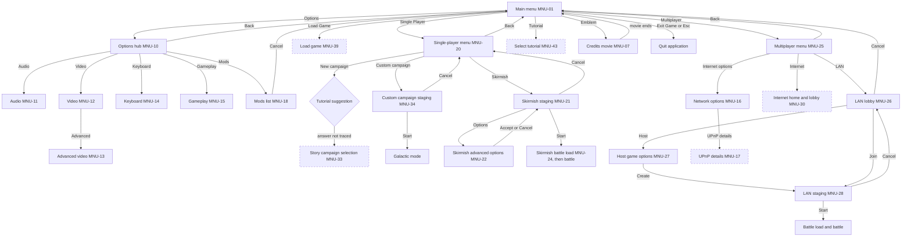

# Menu screens: retail out-of-game inventory and flow

Status: research, 2026-10-11 (legacy EAWR-2923, EAWR-2924). It lists every out-of-game screen of the retail
game, the buttons on each, what each button opens, the music and sound events, the art and data it uses, and
our status. It is the input to the menu-shell and settings tickets. Design base: [ui-layer.md](ui-layer.md)
(UI-L, UI-T, UI-S rules), [mod-hud-survey.md](mod-hud-survey.md) (mod changes), the skirmish walk
[walks/skirmish-setup.md](../behaviour/walks/skirmish-setup.md) (WSS rules) and the
[loading screen note](../behaviour/loading-screen.md) (BLD rules).

Scope: the screens a player reaches from the main menu, the game's options and in-game menu pages, the
load and save screens, campaign and galactic front-end screens (listed as blocked), and message boxes.
Pure in-battle HUD dialogs are out of scope. The appendix lists every dialog in the retail resource script
with its disposition.

## Method and evidence

| Key | Evidence | What it gives |
|---|---|---|
| E-RC | The retail dialog resource script and its resource IDs (Patch2 data, read locally, not committed) | Dialog sizes, controls, `TEXT_*` captions, `IDC_*` gadget names |
| E-XML | The effective FoC XML (GUI skin, music events, sound events, movies, game constants) | Skin textures, `Main_Menu_Music_Event`, `GUI_*` sound events, `Credits` movie, menu backdrop names |
| E-DBG | The FoC debug build, read-only in Ghidra on the research host, 37 dialog callbacks and activation functions decompiled on 2026-10-11 | Which button opens which screen, what it stops, starts or saves |
| E-CAP | A retail capture of the main menu at 1280 by 720 (ignored local set, 2026-10-07) | Layout and art of the main menu |
| E-CODE | Our code at `25df2327` | Our status |
| E-WALK | Existing rule notes: WGP-28/29/40, WSS-01..34, BLD-01..14, UI-L1..L4, UI-S1 | Rules already sourced |

Where a button's target is named from the dialog's own name and not from E-DBG, the row says "by name".
Debug-build evidence cites rule IDs in this note; no original names, addresses or code are copied here.

Status words: **done** (built and reachable), **partial** (part of the screen exists), **missing** (not
built), **blocked** (waits on a game part we do not have: land, story campaigns, GC, a platform service or a
save format), **dead** (the retail code has a handler for a control that the retail resource script does not
contain, so no player can press it), **hidden** (retail hides or disables it on open), **excluded** (not an
out-of-game screen; see the appendix).

Mod rule (owner, 2026-10-10): menu content comes from the loaded data. The dialog list, the map and campaign
lists, the faction names, the backdrop, the music and the movies are read through the same loaders as the
rest of the game. No fixed list of FoC names is hard-coded here, and a mod that removes a dialog removes its
entry, with one diagnostic (EAWR-UI-0201 style), never a crash.

## Flow overview

The graph below shows the out-of-game flow. Solid edges are the retail buttons. Dashed nodes are blocked.
Full rows follow in the tables.

## What mods change

From [mod-hud-survey](mod-hud-survey.md) §2.3 and the data read above:

- **Resized menus.** Some mods widen the main, options and multiplayer menus from 512 to 1024 units (the
  survey's C2 class). Placement follows the upper-right preset (UI-L4), so the widths follow the mod's
  dialog, never a fixed size.
- **Dialogs removed or swapped.** The mods list dialog is removed in the surveyed mods, so the mods button
  (MNU-10) must hide with one diagnostic. One mod swaps two tech-tree dialogs.
- **A malformed dialog.** Three surveyed mods ship an empty field (`215,,22`) in the main-menu dialog. The
  loader rejects that one dialog and keeps the rest (EAWR-UI-0201 style). The main menu must then fall back to
  a diagnostic and stay usable, not stop.
- **Data, not code.** The menu backdrop (`Localized_Menu_Overlay`), the menu music
  (`Main_Menu_Music_Event`), the credits movie (`Credits`), the campaign and map lists, the faction names and
  the tutorial list all come from the loaded data. A mod that changes them changes the menu with no code change.
- **Open question carried over.** Whether the retail menu binds a dialog by name or by resource ID (mod-hud-survey
  F3). The rows here use names; the loader must keep both working until the question is settled.

## Main menu (MNU-01 to MNU-09)

| ID | Screen and controls (`TEXT_*` keys) | Opens or does | Music, sound, art, data | Status | Source |
|---|---|---|---|---|---|
| MNU-01 | Main-menu screen `IDD_MAIN_MENU_DIALOG`, 512 by 1024 units, placed by the upper-right preset (UI-L4), modal. Title `TEXT_MAIN_MENU` (centred). Buttons: MNU-02 to MNU-08 and the hidden entries of MNU-09. | Opens first on start-up. Escape quits the application, as Exit does (E-DBG). | Starts `Main_Menu_Music_Event` in the main-menu music mode on activation (E-XML: 80 % volume, loops, previous track fades out over 2 s). Frame background `MenuBack_overlay_panel.tga`. Full-screen backdrop: the `Localized_Menu_Overlay` name for the language (English `Menuback_Overlay.TGA`, with a default fallback). Fades up from black over 2 s, first showing only. Version text bottom-left. Demo attract scene behind the menu when `Main_Menu_Demo_Attract_Mode` is Yes (stock value Yes; E-DBG starts the attract on activation; the capture's 3D ship fits, not checked frame by frame). The battle's rules, timers and keys are [main-menu-attract.md](../behaviour/main-menu-attract.md) (MAT-01 to MAT-21). | partial: the attract battle itself is done (`AttractRunner`, `apps/viewer/src/attract_runner.cpp`, reached by the `--eawr-attract` flag; the front end starts and stops it once the menu shell lands) (legacy EAWR-2937); the menu's own screen is missing | E-RC, E-XML, E-DBG, E-CAP |
| MNU-02 | `TEXT_BUTTON_SINGLE_PLAYER_GAMES` (`IDC_MAIN_MENU_SINGLE_PLAYER_GAMES`), enabled | Opens the single-player menu MNU-20. Hides the main menu. | Single-player menu issues `Main_Menu_Music_Event` on open (E-DBG). A playing track keeps its loop phase; a stopped track starts (FES-03, owner retail observation, 2026-10-12). | missing | E-RC, E-DBG |
| MNU-03 | `TEXT_BUTTON_MULTIPLAYER` (`IDC_MAIN_MENU_MULTIPLAYER`), enabled | Opens the multiplayer menu MNU-25. | Hides the main menu. | missing | E-RC, E-DBG |
| MNU-04 | `TEXT_BUTTON_LOAD_GAME` (`IDC_LOAD_GAME_MAIN`), enabled | Opens load game MNU-39 with its "from main menu" flag, so Cancel returns here. | None traced. | blocked (the screen exists; the restore hand-off from the front end is GC's, see Load and save) | E-RC, E-DBG |
| MNU-05 | `TEXT_BUTTON_OPTIONS` (`IDC_OPTIONS`), enabled | Opens the options hub MNU-10. | None traced. | missing | E-RC, E-DBG |
| MNU-06 | `TEXT_BUTTON_TUTORIAL` (`IDC_MAIN_MENU_TUTORIAL`), enabled | Opens the tutorial picker MNU-43. | None traced. | blocked (tutorial maps and scripts are not wired) | E-RC, E-DBG |
| MNU-07 | Emblem button `IDC_MENU_CREDITS` (no caption, 160 by 160 units, over the crest art). The same button sits on the options hub, the multiplayer menu and the single-player menu. | Stops the attract scene and any movie, hides the main menu and plays the `Credits` movie (E-XML: `credits_loop.bik`, overlay, has credits) with the `CreditsText` lines and three logos scrolling up over it (E-DBG, [CRD-01 to CRD-10](../behaviour/credits-roll.md)). When the roll has scrolled off the main menu returns (E-DBG). | Movie data from the movies list, so a mod can replace it. | partial: the credits screen exists (`EawrCreditsScreen`, standalone `--eawr-credits`; the movie over the HUD movie player, the CreditsText roll and logos, Esc or click skips, [credits-roll.md](../behaviour/credits-roll.md)); the front-end shell does not wire the crest to it yet, and the credits music is missing | E-RC, E-XML, E-DBG, E-CAP |
| MNU-08 | `TEXT_BUTTON_EXIT_GAME` (`IDC_MAIN_MENU_EXIT2`) and Escape | Stops the movie and the attract scene, hides the command bar and quits the application. No confirmation box in this handler (E-DBG). | None traced. | missing (trivial to build) | E-RC, E-DBG |
| MNU-09 | Entries that retail does not show to players: (a) `IDC_MAIN_MENU_RESUME_GAME` has a handler (auto-load of the autosave, enabled only when an autosave exists) but **no control in the retail script** (the effective `guidialogs.xml` has the name only as a font-settings entry); (b) `IDC_MAIN_MENU_PLAY_DEMO` / `TEXT_BUTTON_PLAY_DEMO` is disabled and hidden on open; (c) `IDC_MENU_PETRO_LOGO`, a logo button drawn at the screen's lower-left, outside the dialog's left edge, opens a platform publisher overlay. | (a) dead; (b) hidden; (c) platform overlay. | No sound. The logo is not ported (a platform overlay has no equivalent here); this is an owner decision to confirm (see result.md). | (a) dead, (b) hidden, (c) not planned | E-RC, E-DBG, E-CAP |

## Options (MNU-10 to MNU-19)

| ID | Screen and controls (`TEXT_*` keys) | Opens or does | Music, sound, art, data | Status | Source |
|---|---|---|---|---|---|
| MNU-10 | Options hub `IDD_MAIN_OPTIONS_DIALOG`, same size and skin as MNU-01. Title `TEXT_MAIN_OPTIONS`. Buttons: `TEXT_AUDIO_OPTIONS` (MNU-11), `TEXT_VIDEO_OPTIONS` (MNU-12), `TEXT_KEYBOARD_OPTIONS` (MNU-14), `TEXT_GAME_OPTIONS` (MNU-15), `TEXT_MODS_OPTIONS` (MNU-18), `TEXT_BUTTON_BACK` (returns to MNU-01). The network page is not on this hub; it opens from the multiplayer menu (MNU-25). The emblem is MNU-07. | Each button hides the hub and opens its page. Back shows the main menu. The same callback serves the in-game options (MNU-19); the in-game page returns to the in-game menu. | Same backdrop and frame as MNU-01. The button for mods depends on the mods dialog (MNU-18): mods that remove that dialog must hide the button with one diagnostic (E-XML and [mod-hud-survey](mod-hud-survey.md) §2.3). | missing | E-RC, E-DBG, E-XML |
| MNU-11 | Audio `IDD_AUDIO_OPTIONS_DIALOG`, 551 by 372. Title `TEXT_AUDIO_OPTIONS`. Sliders: `TEXT_MASTER_VOLUME`, `TEXT_SOUND_EFFECTS_VOLUME`, `TEXT_DIALOG_VOLUME`, `TEXT_MUSIC_VOLUME`. Combo: `TEXT_AUDIO_3D_TECHNOLOGY` (list from the audio device). Check: `TEXT_CHECK_USE_MOVIE_SUBTITLES`. Buttons: `TEXT_BUTTON_DEFAULTS`, `TEXT_BUTTON_ACCEPT`, `TEXT_BUTTON_CANCEL`. | Accept writes the four volumes and the subtitle mode to the player profile and saves it, then returns to MNU-10. Cancel returns to MNU-10. Defaults resets the sliders and the subtitle check. | Dragging the sound-effects slider plays `GUI_Audio_Options_SFX_Test`; dragging the dialog slider plays a speech sample (`Test_Speech_ENG.MP3`, the speech audition) (E-DBG). Music slider: no audition traced. | missing | E-RC, E-DBG, E-XML |
| MNU-12 | Video `IDD_VIDEO_OPTIONS_DIALOG`, 570 by 454. Title `TEXT_VIDEO_OPTIONS`; resolution list with `TEXT_VIDEO_RESOLUTION`. Sliders: `TEXT_ANTI_ALIASING` (`TEXT_OFF`..`TEXT_MAX`), `TEXT_DETAIL_LEVEL` (`TEXT_LOW`..`TEXT_MAX`), `TEXT_GAMMA`. Checks: `TEXT_CHECK_USE_WINDOWED_MODE`, `TEXT_CHECK_VSYNC_ENABLED`, `TEXT_CHECK_WIDESCREEN`, `TEXT_CHECK_USE_HARDWARE_MOUSE`. Buttons: `TEXT_BUTTON_AUTO_DETECT`, `TEXT_BUTTON_ADVANCED` (MNU-13), `TEXT_BUTTON_APPLY`, `TEXT_BUTTON_ACCEPT`, `TEXT_BUTTON_CANCEL`. | Advanced opens MNU-13. Auto-detect applies the renderer's recommended detail settings (E-DBG). The Apply, Accept and Cancel branches are not traced in full. | Presets come from the graphics detail table in the effective data (`GRAPHICDETAILS.XML`, in the config archive, as the retail capture tool reads it). Nothing sounds. | missing (renderer settings exist as viewer flags, not as a menu page) | E-RC, E-XML, E-CAP (capture metadata) |
| MNU-13 | Advanced video `IDD_ADVANCED_VIDEO_OPTIONS_DIALOG`, 571 by 454. Seven sliders, each with low and high end labels: `TEXT_PARTICLE_DETAIL`, `TEXT_MESH_DETAIL`, `TEXT_TEXTURE_MIP_LEVEL`, `TEXT_WATER_DETAIL_LEVEL`, `TEXT_SHADER_DETAIL_LEVEL`, `TEXT_SHADOW_DETAIL`, `TEXT_ENVIRONMENT_DETAIL`. Checks: `TEXT_CHECK_SOFT_SHADOWS`, `TEXT_CHECK_BLOOM`, `TEXT_CHECK_HEAT_DISTORTIONS`. Buttons: `TEXT_BUTTON_AUTO_DETECT`, `TEXT_BUTTON_APPLY`, `TEXT_BUTTON_ACCEPT`, `TEXT_BUTTON_CANCEL`. | As MNU-12, one level down. Cancel returns to MNU-12. | Nothing sounds. | missing | E-RC |
| MNU-14 | Keyboard `IDD_KEYBOARD_OPTIONS_DIALOG` (page 1, 880 by 542, 59 controls), with pages `IDD_KEYBOARD_OPTIONS_DIALOG_2` (58 controls), `IDD_KEYBOARD_OPTIONS_DIALOG_3` (53), `IDD_KEYBOARD_OPTIONS_DIALOG_4` (57) and `IDD_KEYBOARD_OPTIONS_DIALOG_5` (77), all 880 by 542. A control count is every control statement in the script's block, default push buttons included. Each binding row is a `TEXT_*` label with its key buttons. Page buttons on page 1 open the other pages. Buttons: `TEXT_BUTTON_BACK` (MNU-10), `TEXT_BUTTON_ACCEPT` (commits the temporary key map to the profile), `TEXT_BUTTON_RESTORE_KEYBOARD_DEFAULTS`. | Accept commits and saves the profile and disables itself until the next change. Restore defaults rebuilds the temporary key map from the engine defaults. | The map is part of the player profile. Default bindings: the engine's keyboard-map defaults (not traced in this pass). | missing (the camera bindings are a separate file; no key-map page) | E-RC, E-DBG |
| MNU-15 | Gameplay `IDD_GAMEPLAY_OPTIONS_DIALOG`, 540 by 542. Sliders: `TEXT_GAME_SPEED` (tactical), `TEXT_GALACTIC_GAME_SPEED` (galactic), `TEXT_SCROLL_SPEED`. Difficulty radios: `TEXT_DIFFICULTY_EASY_NAME`, `TEXT_DIFFICULTY_NORMAL_NAME`, `TEXT_DIFFICULTY_HARD_NAME`. Checks: `TEXT_ALTERNATE_MOUSE_CONTROLS`, `TEXT_SCROLL_ABSOLUTE`, `TEXT_RIGHT_MOUSE_BUTTON_SCROLL`, `TEXT_BOTH_MOUSE_BUTTONS_ROTATE`, `TEXT_SIMPLIFIED_FACTION_COLORS`, `TEXT_ABILITIES_DEFAULT_TO_AUTOFIRE`, `TEXT_DELAY_TOOLTIP_POPUP`, `TEXT_ASK_BUTTON_AUTO_RESOLVE`. Buttons: `TEXT_BUTTON_DEFAULTS`, `TEXT_BUTTON_ACCEPT`, `TEXT_BUTTON_CANCEL`. | Each difficulty radio sets the game mode's difficulty when clicked (single-player skirmish). Accept stores the options. Cancel returns to MNU-10. Defaults resets the page (E-DBG). | Game-speed steps: [WSS-34](../behaviour/walks/skirmish-setup.md) (five steps, default 2). Auto-resolve question and the galactic speed slider belong to GC. | missing; galactic speed and auto-resolve blocked (GC) | E-RC, E-DBG, E-WALK |
| MNU-16 | Network `IDD_NETWORK_OPTIONS_DIALOG`, 579 by 711. Port: `TEXT_USE_DEFAULT_PORT` (check), `TEXT_GAME_PORT` (edit). Checks: `TEXT_ALLOW_NAT_NEGOTIATION`, `TEXT_USE_WINDOWS_FIREWALL`, `TEXT_ENABLE_UPNP`. Information block: `TEXT_HOST_IP`, `TEXT_INTERNET_IP`, `TEXT_WINDOWS_FIREWALL_ENABLED`, `TEXT_UPNP_FRAMEWORK_ENABLED`, `TEXT_UPNP_DEVICES`. Buttons: `TEXT_REFRESH_NETWORK_INFO`, `TEXT_UPNP_DETAILS` (MNU-17), `TEXT_BUTTON_DEFAULTS`, `TEXT_BUTTON_ACCEPT`, `TEXT_BUTTON_CANCEL`. Internet combos: `TEXT_INTERNET_CONNECTION_SPEED`, `TEXT_PREFERRED_SERVER_LOCALE`, `TEXT_PREFERRED_QUICKMATCH_FACTION`, `TEXT_QUICKMATCH_HOST_DEFAULT`. | Cancel (`IDC_BACK`, caption `TEXT_BUTTON_CANCEL`) and Accept (`IDC_OK`) return to the multiplayer menu when opened from there (MNU-25). In game they return to the in-game options page (MNU-19; not traced). The page is not on the options hub (MNU-10). Refresh queries the host addresses and the firewall and UPnP state. | Data: the network profile (port, NAT, UPnP, firewall flags, connection speed, locale, quick-match defaults). The LAN match uses its own fixed default port (`src/platform/net/lan_match.hpp`). | missing; internet fields and NAT and UPnP blocked (platform service) | E-RC, E-DBG, E-CODE |
| MNU-17 | UPnP details `IDD_UPNP_DETAILS_DIALOG`, 700 by 472. Title `TEXT_UPNP_DETAILS`, device list, `TEXT_BUTTON_CANCEL`. | Cancel returns to MNU-16. | None. | blocked (NAT traversal for internet games) | E-RC, E-DBG |
| MNU-18 | Mods list `IDD_SELECT_MOD_DIALOG`, 620 by 520. Title `TEXT_SELECT_MOD_TITLE`, mod list, `TEXT_BUTTON_SELECT`, `TEXT_BUTTON_CANCEL`. | Cancel returns to the main menu, not the options hub (E-DBG). Select loads the chosen mod (handler not traced). | The list reads the installed mods; a mod that removes this dialog removes the entry ([mod-hud-survey](mod-hud-survey.md) §2.3, row "Removed", for the surveyed mods). | missing; the mod loader exists ([mod-loading walk](../behaviour/walks/mod-loading.md)) with no menu list | E-RC, E-DBG, E-CODE |
| MNU-19 | In-game menu `IDD_GAME_OPTIONS_DIALOG`, 321 by 328, title `TEXT_GAME_OPTIONS_TITLE`: `TEXT_BUTTON_SAVE_GAME` (MNU-40), `TEXT_BUTTON_LOAD_GAME` (MNU-39), `TEXT_BUTTON_OPTIONS`, `TEXT_BUTTON_QUIT_GAME` (confirm, MNU-42), `TEXT_BUTTON_RESUME_GAME`. In-game options `IDD_IN_GAME_OPTIONS_DIALOG`, 321 by 328: `TEXT_AUDIO_OPTIONS`, `TEXT_VIDEO_OPTIONS`, `TEXT_NETWORK_OPTIONS`, `TEXT_KEYBOARD_OPTIONS`, `TEXT_GAME_OPTIONS`, `TEXT_BUTTON_BACK`. | The in-game menu opens while a single-player skirmish runs and pauses it (UI-S1). Its options button shows the in-game page, which opens the same pages MNU-11, 12, 14, 15 and 16 (no mods button). Back returns to the in-game menu. Quit asks for confirmation, then quits. Resume closes it (handler not traced). | Pausing: UI-S1 in [ui-layer.md](ui-layer.md). | done for a skirmish battle (legacy EAWR-3925): Escape and the HUD's options button (`b_option_t`, tooltip `TEXT_BUTTON_MAIN_MENU`) open it as `EawrOptionsScreen::Page::game_menu`, the battle pauses behind it (not in multiplayer), Options opens the in-game hub (Back returns), Quit Game asks `TEXT_QUIT_SURE` and Yes frees the battle and shows the front end's main menu; Save and Load are disabled (deviation: retail enables them in a single-player skirmish; no skirmish player save exists here yet; follow-up (legacy EAWR-3989)). The campaign's Escape menu (`GalacticSaveControls`) has the same Options and Quit Game, and its Quit Game and the score screen's Main Menu return to the main menu; the pages follow MNU-11 to 16 | E-RC, E-DBG, E-WALK |

## Skirmish and multiplayer (MNU-20 to MNU-32)

| ID | Screen and controls (`TEXT_*` keys) | Opens or does | Music, sound, art, data | Status | Source |
|---|---|---|---|---|---|
| MNU-20 | Single-player menu `IDD_SINGLE_PLAYER_GAMES_MENU_DIALOG`, 512 by 1024, upper-right. Title `TEXT_SINGLE_PLAYER_GAMES_MENU_TITLE`. Buttons: `TEXT_BUTTON_NEW_CAMPAIGN`, `TEXT_BUTTON_CUSTOM_CAMPAIGN`, `TEXT_BUTTON_SKIRMISH`, `TEXT_BUTTON_BACK`, `TEXT_BUTTON_DEBUG_LOAD_SKIRMISH_MAP`. Hint list (listbox, `IDC_HINT_LIST`, hidden on open). Emblem (MNU-07). The close button is hidden on open. | New campaign: if the profile has not played the tutorial, asks `TEXT_SUGGEST_TUTORIAL` (yes or no box) and records the answer, then opens the story campaign selection MNU-33 (which answer goes where: not traced). Custom campaign opens MNU-34. Skirmish opens MNU-21. Back shows the main menu. The open handler does not hide the debug skirmish-map button, so it shows in the retail flow; it opens the map list MNU-23. A handler for `IDC_CONTINUE_CAMPAIGN_BUTTON` has **no control** in the retail script (dead). | Issues `Main_Menu_Music_Event` on open (E-DBG). A playing track keeps its loop phase; a stopped track starts (FES-03, owner retail observation, 2026-10-12). The hint list's text source is not traced. | partial: the menu is built from the catalogue dialog (`apps/viewer/src/front_end_mode.cpp`). Custom campaign opens MNU-34 (off, with a reason, only while the data lists no campaign), skirmish is enabled, new campaign stays blocked (story). Continue: the retail dialog has no control, so none is added; continuing a campaign is Load Game (MNU-39), which lists campaign saves, and a mod's dialog that carries the control shows it disabled | E-RC, E-DBG, E-XML, E-CODE |
| MNU-21 | Skirmish staging `IDD_SKIRMISH_STAGING_DIALOG`, 965 by 422. Title `TEXT_SKIRMISH_HOST_GAME_TITLE`. Game-type list (`IDC_GAME_TYPE_LIST`, `TEXT_GAME_TYPE_CLIENT_INFO`). Map list (`IDC_STAGING_MAP_LIST`) with `TEXT_BUTTON_SELECT_OFFICIAL_MAPS` and `TEXT_BUTTON_SELECT_CUSTOM_MAPS`. Preview (`IDC_IMAGE`) and description box. Eight player rows (`IDC_PLAYER_NAME_0..7`, `_FACTION_`, `_COLOR_`, `_TEAM_`). Buttons: `TEXT_SELECT_OPTIONS` (MNU-22), `TEXT_BUTTON_START_GAME`, `TEXT_BUTTON_CANCEL`. | Map selection updates the preview, description and the remembered map ([WSS-02, WSS-06](../behaviour/walks/skirmish-setup.md)); official and custom switch the list ([WSS-07](../behaviour/walks/skirmish-setup.md)). Start validates: at least two players, two or more teams, one faction per team, and map availability. A failure opens a message box with the `TEXT_LAN_HOST_*` or `TEXT_MAP_NOT_AVAILABLE_TO_PLAY` text (MNU-42), and the staging stays. A valid start loads the battle (MNU-24). Cancel returns to MNU-20 in single player, otherwise to MNU-01. Row rules: [WSS-08 to WSS-21](../behaviour/walks/skirmish-setup.md). | Validation boxes use the dialog-box sounds (not traced). | done for the screen and its rules (`apps/viewer/src/skirmish_setup_mode.cpp`, reached by the `--eawr-skirmish-setup` flag only), built from the catalogue dialog under the retail layout rules with every caption a `TEXT_*` key ([R-SETUP-06](../behaviour/skirmish-setup.md)). Land and land control are listed and disabled. Partial against retail: no menu route yet (the shell hands over through the Cancel request), start-check messages shown in a status line instead of a message box, open rows enabled in retail and disabled here, LAN panel not part of the retail dialog | E-RC, E-DBG, E-WALK, E-CODE |
| MNU-22 | Skirmish advanced options `IDD_INTERNET_STAGING_DIALOG_ADVANCED_SKIRMISH_OPTIONS`, 598 by 377. Title `TEXT_SKIRMISH_ADVANCED_OPTIONS_HEADER`. Credits slider (`TEXT_SKIRMISH_CREDITS`). Checks: `TEXT_ALLOW_HEROES`, `TEXT_FREE_STARTING_UNITS`, `TEXT_ALLOW_SUPER_WEAPONS`, `TEXT_PRE_BUILT_BASE`. Win-condition combo (`TEXT_WIN_CONDITION`). Buttons: `TEXT_BUTTON_DEFAULTS`, `TEXT_BUTTON_ACCEPT`, `TEXT_BUTTON_CANCEL`. The same callback serves the campaign page MNU-35. | Edits a copy. Accept sends it back to the staging (MNU-21, or MNU-28 for LAN). Cancel discards. Defaults resets the copy. The pre-built base check is hidden and unchecked in space ([WSS-27](../behaviour/walks/skirmish-setup.md)). Win condition: two choices in space ([WSS-31](../behaviour/walks/skirmish-setup.md)). Credits use the authored bounds (stock 2000 to 8000), clamping existing values without rounding ([WSS-25](../behaviour/walks/skirmish-setup.md)). | Rules: [WSS-22 to WSS-34](../behaviour/walks/skirmish-setup.md). | partial: the dialog is the catalogue's, with the heroes, free-starting-units and superweapons checks as `TEXT_*` captions and the pre-built base hidden in space; the credits slider takes its bounds from `Min_Skirmish_Credits` and `Max_Skirmish_Credits` and shows the data's default clamped into those bounds without rounding, disabled with its reason, because a battle does not apply the selected credits yet (legacy EAWR-727); the win condition lists the two space choices (WSS-31) and the chosen one reaches the battle's victory rules. LAN and online staging (MNU-28): the host opens the same dialog from `IDC_SELECT_OPTIONS` while the room is staging; Accept publishes the options in the host-owned lobby game, so every peer gets them, the setup hash covers them and the started match applies them (a refused publish, such as a room that is starting, restores the previous values). A joiner's options button is hidden and the summary list shows the host's values read-only (legacy EAWR-4041) | E-RC, E-DBG, E-WALK, E-CODE |
| MNU-23 | Map lists: load map `IDD_LOAD_MAP_DIALOG` (`TEXT_SAVED_MAPS`, list, `TEXT_BUTTON_LOAD`, `TEXT_BUTTON_PLAYBACK_GAME`, `TEXT_BUTTON_RECORD_GAME`, `TEXT_BUTTON_CANCEL`); select map `IDD_SELECT_MAP_DIALOG` (`TEXT_SELECT_MAP_TITLE`, list, `TEXT_SELECT_MAP_BUTTON`, `TEXT_BUTTON_CANCEL`); buy units `IDD_SKIRMISH_BUY_UNITS_DIALOG` (`TEXT_SKIRMISH_BUY_UNITS_MENU_TITLE`, forces list, `TEXT_SKIRMISH_BUY_UNITS_CHOICES`, `TEXT_SKIRMISH_BUY_UNITS_CREDITS_BALANCE`, `TEXT_BUTTON_BUY`, `TEXT_BUTTON_SELL`, `TEXT_BUTTON_SELL_ALL`, `TEXT_BUTTON_START_GAME`, `TEXT_BUTTON_CANCEL`, unit image). | Load map: Cancel returns to MNU-20; Playback opens the replay list MNU-41. Callers of the select-map and buy-units screens are not traced. [WSS-28](../behaviour/walks/skirmish-setup.md) says an ordinary Start does not pass through a buy screen. | None traced. | missing; callers of select-map and buy-units open | E-RC, E-DBG, E-WALK |
| MNU-24 | Skirmish battle load `IDD_SKIRMISH_BATTLE_LOAD_DIALOG`, 975 by 718, full screen. Begin button `TEXT_BUTTON_BEGIN` (`IDC_BEGIN_BUTTON`, appears when ready). Captions: planet name, `TEXT_TERRAIN_TYPE`, `TEXT_AVG_WEATHER`, `TEXT_NATIVE_POPULATION`, loading message `TEXT_SAVELOAD_LOADING_MSG`, a historical-reference label, and the planet, map, weather and native icons. | Shows while the battle prepares; Begin starts it ([BLD-01 to BLD-14](../behaviour/loading-screen.md)). | No music event is started by the loading screen (none in its code). Battle-load music events exist in the effective data (`Tactical_Battle_Load_Screen_Music_Event`, `Tactical_Battle_Loading_Loop_Event`); which one applies is not traced here. Dialog-skin backdrop: the dialog's own frame. | done (`apps/viewer/src/loading_screen.cpp`); music not wired | E-RC, E-WALK, E-CODE, E-XML |
| MNU-25 | Multiplayer menu `IDD_MULTIPLAYER_DIALOG`, 512 by 1024. Title `TEXT_MULTIPLAYER`. Buttons: `TEXT_BUTTON_MULTIPLAYER_INTERNET`, `TEXT_BUTTON_MULTIPLAYER_LAN`, `TEXT_BUTTON_INTERNET_OPTIONS` (MNU-16), `TEXT_BUTTON_BACK`. Emblem (MNU-07) and logo (MNU-09). | LAN opens MNU-26. Internet opens MNU-30. Internet options opens MNU-16, and its Back returns here. Back shows MNU-01. | As MNU-01. | missing here (the front-end shell owns this menu); the LAN entry opens the LAN screens object (`EawrLanLobby`, [lan-lobby.md](lan-lobby.md)); internet entry blocked | E-RC, E-DBG |
| MNU-26 | LAN lobby `IDD_LAN_LOBBY_DIALOG`, 955 by 701, full-screen opaque. Title `TEXT_LAN_LOBBY_TITLE`. Name edit (`TEXT_LAN_NAME`, 20 characters), colour combo (the nine multiplayer colours), player list (`TEXT_LAN_PLAYERS`), game list with sort buttons (`TEXT_INTERNET_SERVER_NAME_BUTTON`, `TEXT_INTERNET_PING_BUTTON`, `TEXT_INTERNET_MAP_NAME_BUTTON`, `TEXT_INTERNET_PLAYERS_BUTTON`, `TEXT_INTERNET_GAME_TYPE_BUTTON`), a second, short list (`IDC_GAME_LIST2`, no use in the debug build), `TEXT_BUTTON_SET_FILTER`, chat list and edit (128 characters), `TEXT_BUTTON_HOST_GAME`, `TEXT_BUTTON_JOIN_GAME`, `TEXT_BUTTON_CANCEL`. | Host opens the host options page MNU-27 in its LAN mode. Join, or a double click on a game, runs the join checks (a game selected, the version, a free slot, a unique name, the password; each failure is a red chat line) and opens the staging MNU-28 as joiner. Set filter opens `IDD_LOBBY_GAME_LIST_FILTER_DIALOG` (645 by 276: game type, minimum and maximum players, maximum ping; Accept, Cancel, `TEXT_BUTTON_CLEAR_FILTERS`). Sort buttons re-sort. Cancel and Esc shut the LAN session down and return to **MNU-01**, not to MNU-25. Name and colour write the player profile. The list rebuilds once a second. | Chat send plays `GUI_Common_Chat_Send`. Chat receive: the debug build asks for `GUI_Common_Chat_Receive`, the effective XML names `GUI_Common_Chat_Recieve` (misspelt); the screen resolves the name against the data (rules LLB-01 to LLB-07 in [lan-lobby.md](lan-lobby.md)). | done (`apps/viewer/src/lan_lobby_screen.cpp`, reached by the `--eawr-lan-lobby` flag; the shell wires the menu entry). The game list comes from a `LobbyGameSource` (LLB-10 to LLB-12), fed by UDP presence datagrams (LLB-13 to LLB-16); a game can also be joined by address (MNU-29). Gaps: ping is unknown, the profile is not stored, sort direction of a repeated press is not traced | E-RC, E-DBG, E-XML, E-CODE |
| MNU-27 | Host game options `IDD_INTERNET_HOST_OPTIONS_DIALOG`, 595 by 377. Title `TEXT_INTERNET_HOST_GAME_OPTIONS`. Game name (`TEXT_INTERNET_GAME_NAME`, 24 characters), password (`TEXT_INTERNET_GAME_PASSWORD`, 16 characters, shown as a password), game-type list (four types) with a description, clan combo (`TEXT_INTERNET_GAME_HOST_CLAN`, hidden on open). Buttons: `TEXT_INTERNET_CREATE_GAME_BUTTON`, `TEXT_BUTTON_CANCEL`. | **The LAN lobby's Host opens this dialog** (the debug build calls it with a LAN flag; the 620 by 520 LAN host dialog MNU-28a has no caller). Create (or Enter in an edit) needs a non-empty name, refocuses the name edit when it is empty, saves the last game name and game type to the profile and opens the staging as host. Cancel and Esc return to MNU-26. | Writes the last game name and type. | done (LAN mode); password disabled and clan hidden (D-b, internet-lobby features); only the space game type is enabled | E-RC, E-DBG |
| MNU-28 | LAN staging `IDD_LAN_STAGING_DIALOG`, 955 by 701, full-screen opaque. Title `TEXT_INTERNET_HOST_GAME_TITLE` (`TEXT_INTERNET_JOIN_GAME_TITLE` for a joiner). Map buttons (`TEXT_BUTTON_SELECT_OFFICIAL_MAPS`, `TEXT_BUTTON_SELECT_CUSTOM_MAPS`), map list, preview. Options (`TEXT_SELECT_OPTIONS`, MNU-22). Load (`TEXT_BUTTON_INTERNET_LOAD`, `IDC_LOAD_GAME`, host and campaign games only). **Nine** player rows (`IDC_PLAYER_NAME_0..8`, faction, colour, team, accepted icon). Chat list and edit. Buttons: `TEXT_BUTTON_CANCEL`, `TEXT_BUTTON_START_GAME` (`TEXT_BUTTON_ACCEPT` for a joiner). | Cancel and Esc leave the game and return to MNU-26. The host's row choices are none, open (`TEXT_OPEN_PLAYER`) and the easy, medium and hard AI. Start checks, in order: a map is listed, two humans are in the game, two or more teams, one faction per team; each failure is a red chat line (`TEXT_LAN_HOST_MIN_PLAYERS`, `TEXT_LAN_HOST_NOT_ENOUGH_TEAMS`, `TEXT_LAN_HOST_MISMATCHED_FACTIONS`). A joiner's Accept checks that the map is available (`TEXT_MAP_NOT_AVAILABLE_TO_PLAY`) and the teams. The host's Start is enabled while two humans are in and all accepted. | Chat send `GUI_Common_Chat_Send`. The system update refreshes the player list once a second. | done for the rows, checks and flow (rules LLB-08 and LLB-09 in [lan-lobby.md](lan-lobby.md)). Gaps: the accept is not shown before Start, the joiner sees the setup only after Start (legacy EAWR-2152), two humans at most, eight rows, one AI level. The options button is enabled for the host while staging (legacy EAWR-4041); a joiner sees the values read-only | E-RC, E-DBG, E-CODE |
| MNU-28a | LAN host staging `IDD_LAN_HOST_DIALOG` and LAN join staging `IDD_LAN_JOIN_DIALOG`, both 620 by 520. Host title `TEXT_LAN_HOST_GAME_TITLE`, join title `TEXT_LAN_JOIN_GAME_TITLE`. Both have a player list (`IDC_PLAYER_LIST`) with its caption (`TEXT_LAN_HOST_PLAYERS` or `TEXT_LAN_JOIN_PLAYERS`), a settings caption (`TEXT_LAN_HOST_GAME_SETTINGS` or `TEXT_LAN_JOIN_GAME_SETTINGS`), a chat list and edit, and Cancel (`TEXT_BUTTON_CANCEL`). Host adds Start game (`TEXT_BUTTON_START_GAME`) and a campaign button (`IDC_SELECT_CAMPAIGN`, caption key `TEXT_CAPAIGN`, spelt that way in the script). Join adds Accept (`TEXT_BUTTON_ACCEPT`) and, where the host has its campaign button, a static placeholder (`<<! Campaign !>>`). Neither has a name, password, game-type or clan field. | **Not used.** The debug build names neither dialog, so nothing opens them: the LAN flow is MNU-26, MNU-27 and MNU-28. A resource-script leftover, like the dead handlers listed under MNU-09. | None. | not planned (no caller; settled by the 2026-10-11 trace) | E-RC, E-DBG |
| MNU-29 | Direct connect `IDD_IP_DIRECT_CONNECT_DIALOG` (`TEXT_IP_DIRECT_CONNECT`, `TEXT_IP`, address edit, `TEXT_ADD`, address list, `TEXT_BUTTON_CONNECT`, `TEXT_BUTTON_CANCEL`); connect `IDD_MP_CONNECT_DIALOG` (`TEXT_MP_CONNECT_FORMING`, player list, progress bar, cancel); wait `IDD_INTERNET_WAIT_DIALOG` (`TEXT_WAITING_FOR_SERVER`, cancel); password `IDD_ENTER_GAME_PASSWORD_DIALOG` (`TEXT_ENTER_GAME_PASSWORD`, password edit, OK, cancel); disconnect `IDD_DISCONNECT_DIALOG` (`TEXT_CONNECTION_INTERRUPTED`, nine player rows with connection-quality bars and `TEXT_KICK`, chat, `TEXT_BUTTON_DISCONNECT_QUIT`). | **The direct-connect dialog has no caller in the debug build**; the LAN lobby has no button for it. The connect dialog opens after the host's Start; the others belong to the internet lobby or to a running match. Our lobby adds a small button that opens the direct-connect page (an EAWR addition): Add keeps an address for the session, Connect joins the typed or listed address as a joiner, Cancel and Esc return to MNU-26. | Chat: `GUI_Common_Chat_Send`. | direct connect done as an addition (`--eawr-lan-do direct:<ip[:port]>`); connect, wait, password and disconnect not built (password and wait are internet features) | E-RC, E-DBG, E-CODE |
| MNU-30 | Internet home `IDD_INTERNET_HOME_DIALOG` (`TEXT_INTERNET_HOME_TITLE`, message-of-the-day list, players online, games available and in progress counters, `TEXT_BUTTON_QUICK_MATCH`, `TEXT_BUTTON_CUSTOM_MATCH`, `TEXT_BUTTON_COMMUNITY`, `TEXT_BUTTON_PLAYER_PROFILE`, `TEXT_BUTTON_INTERNET_OPTIONS`, `TEXT_BUTTON_INTERNET_BUDDIES`, `TEXT_BUTTON_HOME`, `TEXT_BUTTON_CANCEL`); internet lobby `IDD_INTERNET_LOBBY_DIALOG` (game list, filter, room list, chat, `TEXT_BUTTON_HOST_GAME`, `TEXT_BUTTON_JOIN_GAME`, `TEXT_BUTTON_REFRESH`, `TEXT_IGNORE_PLAYER`); internet staging `IDD_INTERNET_STAGING_DIALOG` (MNU-28 layout plus `TEXT_TEST_CONNECTIONS`, `TEXT_SELECT_CLAN`, buddies). | Most buttons open the platform's own overlays (news, community, profile, settings, friends) or the account and social dialogs (MNU-31, MNU-32). Host and join are not traced; they presumably follow the LAN flow with the platform's game list. | Not traced. | blocked (platform lobby, presence and overlay services; decision needed) | E-RC, E-DBG |
| MNU-31 | Internet login `IDD_INTERNET_LOGIN_DIALOG` (`TEXT_INTERNET_LOGIN_TITLE`, name, password, `TEXT_REMEMBER_PASSWORD`, `TEXT_CREATE_ACCOUNT`, `TEXT_CHANGE_ACCOUNT_INFO`, `TEXT_INTERNET_VIEW_SERVICE_TERMS`, `TEXT_ESRB_WARNING`, `TEXT_CONNECT`, cancel); account `IDD_INTERNET_ACCOUNT_DIALOG` (name, password, `TEXT_EMAIL_ADDRESS`, `TEXT_CREATE`, cancel). | Login connects to the service. Create account opens the account form. | Not traced. | blocked (account service) | E-RC, E-DBG |
| MNU-32 | Buddies `IDD_BUDDY_LIST_DIALOG` (`TEXT_BUDDY_LIST_TITLE`, list, `TEXT_BUDDY_LIST_FIND_BUDDIES`, `TEXT_BUDDY_LIST_REMOVE_BUDDY`, `TEXT_BUDDY_LIST_CHAT_BUDDY`, cancel); search `IDD_BUDDY_SEARCH_DIALOG` (`TEXT_BUDDY_SEARCH_TITLE`, `TEXT_BUDDY_SEARCH_ADD_BUDDY`); messages `IDD_INSTANT_MESSAGE_DIALOG` (`TEXT_INSTANT_MESSAGE_TITLE`, list, edit, close); clan `IDD_CLAN_SELECT_DIALOG` (`TEXT_SELECT_CLAN_DIALOG_HEADER`, `TEXT_BUTTON_SET_CLAN`, `TEXT_BUTTON_OK`). | Social actions on the platform service. Clan picks a clan for the staging. | Not traced. | blocked (platform social service) | E-RC, E-DBG |

## Campaigns and galactic front end (MNU-33 to MNU-38)

Every row here waits on a part we do not have yet: story campaigns, the galactic (GC) custom-campaign
front end, or the land game. Their entries stay visible and disabled. The GC front-end tickets belong to the
GC coordinator: custom-campaign setup and save and load (legacy EAWR-2009), battle loading and summary (legacy EAWR-2010), and campaign end (legacy EAWR-2011). Where a row hands off to GC, the seam is named in the row and in result.md.

| ID | Screen and controls (`TEXT_*` keys) | Opens or does | Music, sound, art, data | Status | Source |
|---|---|---|---|---|---|
| MNU-33 | Story campaign selection `IDD_MAIN_CAMPAIGN_DIALOG`, 918 by 743. Campaign title text (`TEXT_MAIN_MENU_TITLE_2` and the campaign's title key), difficulty radios (`TEXT_DIFFICULTY_EASY_NAME`, `TEXT_DIFFICULTY_NORMAL_NAME`, `TEXT_DIFFICULTY_HARD_NAME`; normal selected on open), faction progress bar (`IDC_LOAD_FACTION_A_PROGRESS`), `TEXT_BUTTON_START_GAME`, `TEXT_BUTTON_BACK`. A handler for `IDC_PLAY_FACTION_A_BUTTON_BIG` has no control in the retail script (dead). The older picker `IDD_CAMPAIGN_SELECTION_DIALOG` (campaign list, difficulty slider, `TEXT_BUTTON_PLAY_FACTION_A`, `TEXT_BUTTON_PLAY_FACTION_B`, cancel) has its callers not traced. | Start loads the campaign and shows the campaign battle load (MNU-37). Back returns to MNU-20. | Campaign sets come from the story campaign data (`story_campaign_*.xml`). Music: main-menu mode. | blocked (story campaigns; GC front-end seam) | E-RC, E-DBG, E-XML |
| MNU-34 | Custom campaign staging `IDD_CUSTOM_CAMPAIGN_STAGING_DIALOG`, 620 by 547. Title `TEXT_BUTTON_CUSTOM_CAMPAIGN`. Official and custom map buttons (`TEXT_BUTTON_SELECT_OFFICIAL_MAPS`, `TEXT_BUTTON_SELECT_CUSTOM_MAPS`, the custom one disabled on open), campaign list (`IDC_STAGING_MAP_LIST`), preview, description (`IDC_CAMPAIGN_DESCRIPTION`), difficulty (`TEXT_CAMPAIGN_DIFFICULTY`, three radios, normal on open), faction combo (`TEXT_CAMPAIGN_SELECT_FACTION`), `TEXT_SELECT_OPTIONS` (MNU-35), `TEXT_BUTTON_START_GAME`, `TEXT_BUTTON_CANCEL` (back to MNU-20). | Start applies the options and the multiplayer game type and starts the chosen campaign (single player: its campaign set, the chosen faction, solo, the chosen difficulty). The list matches the last choice by localised display name. The faction list shows only playable factions; with none chosen, the last one is selected. | [WGP-40 and WGP-29](../behaviour/walks/gc-presentation.md): the opening rules and the start rules. Music: main-menu mode. | partial (legacy EAWR-3164): the screen is built from the catalogue dialog by `apps/viewer/src/campaign_setup_screen.cpp` with the engine-free model `include/eawr/presentation/ui/campaign_setup.hpp` (cases in `tests/ui/campaign_setup_tests.cpp`): the list is the data's listed single-player entries, one per set, sorted by `Sort_Order` then title (WGP-65/66); the faction drop-down lists the playable factions with the last selected (WGP-40); Start needs a row and a faction the set has an entry for and hands that entry to the host through `CampaignStartRequest`, which starts the galactic mode with it; the preview is the shared galaxy backdrop with a blip per planet (WGP-73). Disabled with their reasons: the custom maps button, the easy and hard radios and the options button, because the galactic mode applies no difficulty or custom options yet. Not applied: the profile's last campaign (WGP-66) | E-RC, E-DBG, E-WALK, E-CODE |
| MNU-35 | Campaign advanced options `IDD_CAMPAIGN_ADVANCED_OPTIONS_DIALOG`, 551 by 466. Credits slider (`TEXT_SKIRMISH_CREDITS`), starting tech level (`TEXT_SKIRMISH_STARTING_TECH_LEVEL`) and maximum tech level (`TEXT_SKIRMISH_MAX_TECH_LEVEL`) sliders, `TEXT_ALLOW_AUTORESOLVE` combo, `TEXT_ALLOW_RANDOM_EVENTS` check, `TEXT_BUTTON_DEFAULTS`, `TEXT_BUTTON_ACCEPT`, `TEXT_BUTTON_CANCEL`. | Edits a copy. Accept sends it back to MNU-34. Tech sliders need the campaign's min and max values (the page is a copy of MNU-22 with the campaign data). | Same callback as MNU-22. Credit and tech limits come from the campaign data. | blocked: the dialog is not built; its button on MNU-34 is shown disabled until the galactic mode takes credits, tech levels and auto-resolve | E-RC, E-DBG, E-WALK |
| MNU-36 | Story dialog `IDD_STORY_DIALOG`, 382 by 519 (title key `TXT_STORY_DIALOG_TITLE`, image, text list, `TEXT_BUTTON_ACCEPT`, `TEXT_BUTTON_CANCEL`, `TEXT_BUTTON_CLOSE`). Story summary `IDD_STORY_SUMMARY_DIALOG`, 545 by 572 (`TEXT_STORY_GOALS`, goal list, `TEXT_ACTIVE_STORIES_BUTTON` and `TEXT_COMPLETED_STORIES_BUTTON` radios, `TEXT_BUTTON_ABANDON`, `TEXT_BUTTON_CLOSE`, `TEXT_STORY_HINT`). | Accept and cancel answer a story offer. Abandon drops a story goal. Close returns to the galaxy or the battle. | Story art from the campaign data. | blocked (story system) | E-RC |
| MNU-37 | Campaign loads: space mission `IDD_SPACE_MISSION_LOAD_DIALOG` and land mission `IDD_LAND_MISSION_LOAD_DIALOG` (975 by 718; mission list, planet icon and overlay, terrain, weather and native-population panels, `TEXT_BUTTON_BEGIN`); campaign battle load `IDD_SPACE_BATTLE_LOAD_DIALOG` and `IDD_LAND_BATTLE_LOAD_DIALOG` (975 by 718, 38 controls each, the same family as MNU-24). | Begin starts the mission. The campaign battle load shows its progress as the campaign loads (the progress calls are in the campaign-start handler). | The space battle load is the campaign twin of MNU-24. Music: battle-load events (not traced). | blocked (story and GC; land is not built) | E-RC, E-DBG |
| MNU-38 | Campaign score `IDD_CAMPAIGN_SCORE_DIALOG`, 975 by 718 (victory or defeat title, military, conquest and kill efficiency labels, victory list, image, one quit button). Retry `IDD_RETRY_DIALOG`, 347 by 132 (`TEXT_MISSION_FAILED`, `TEXT_LOAD_AUTOSAVE` as the default button, `TEXT_BUTTON_QUIT_GAME`). | Campaign end returns to the campaign menu or the main menu. Retry loads the autosave (save format needed, MNU-39). | Campaign win and lose music events exist in the effective data (`Empire_Win_Strategic_Event` and related events). | blocked (campaign end; GC hand-off) | E-RC, E-XML |

## Load and save (MNU-39 to MNU-41)

What exists for saving, and what is missing:

- **Script save `eawr-script-save-v4`: exists** on this base. `ScriptScheduler::save` and `load` are declared in `include/eawr/script/authoritative/scheduler.hpp` and implemented in `src/script/authoritative/persistence.cpp`; the design is in `docs/lua-persistence.md`. It saves the authoritative script scheduler only: Lua graphs, object identities, queues and counters, random draw positions, the module manifest digest, the session settings and the completed tick. Mode: the script state of a scripted session. It does not hold skirmish setup, battle, galaxy, profile or option state, and the tactical tick hash does not include scripts yet (an open item in that doc). It is not a player save.
- **Lockstep checkpoint: a requirement, not a save.** `docs/research/multiplayer-feasibility.md` asks for one versioned checkpoint for save, load and resync MPS-4 (legacy EAWR-681) and refuses a second format. The desync monitor keeps bounded in-memory checkpoint encodings for desync reports (`src/net/desync_monitor.cpp`); nothing in it writes a player file.
- **Player save: the checkpoint (owner decision D-i; landed with the GC save system (legacy EAWR-2896)).** `eawr::platform::LiveGameSession` writes `<save directory>/<name>.eawrsave` (`src/platform/galactic/save_repository.cpp`); the viewer's default directory is the user data directory's `saves` folder, and the reserved slots are `Auto Save` and `Quick Save` (stored descriptions `[AutoSave]` and `[QuickSave]`). The in-game dialogs' order key, name rule and enable rules are `apps/viewer/src/galactic/save_dialog_model.hpp` (WGS-152..164, [GC session and save walk](../behaviour/walks/gc-session-save.md)).
- **Saved-game list (MNU-39) (legacy EAWR-2942).** The Load Game screen lists the save directory. Retail shows two columns and nothing else (WGS-155/161: the name, or the localized reserved label, then the local last-write date and time at 68% of the row; no campaign, faction, difficulty or preview), so `LiveSaveSlot` has everything the list needs. The rows come from `apps/viewer/src/saved_games.*` behind the engine-free `SavedGameStore` seam (`include/eawr/presentation/ui/load_game.hpp`): the order is the in-game dialog's key (WGS-156: auto save, quick save, then the newest write first, equal keys in file order), the list stops at the first 100 slots (WGS-161), and an unreadable file is listed with its problem as the tooltip and cannot load. Delete asks `TEXT_DELETE_CONFIRM` and then erases that save by its stored name (WGS-160). The save directory and the names come from the directory (`--eawr-save-dir <dir>` in the gallery); the only fixed names are the two reserved slots the repository itself defines, and their labels are text-database keys.
- **Load from the front end: the screen is built, the restore hand-off is not wired.** Load shows `TEXT_SAVELOAD_LOADING_MSG`, builds a `SavedGameRequest{directory, name}` and gives it to a launcher the screen's owner supplies (`LoadGameContext::launcher`); an empty answer closes the screen with `save_chosen`, a refusal is shown over the screen. With no launcher Load stays off with the reason "starting a saved game from the main menu is not available yet". Two things keep it off, both on the GC side (checked in source) (legacy EAWR-3035): (1) `prepare_load` takes its identities and services from the running session's setup, and the `.eawrsave` header carries only a campaign digest, so a front end cannot tell which campaign (or playable faction) a save belongs to before restoring it; GC puts the campaign and faction into the header and onto `LiveSaveSlot`. (2) The only hand-off today is `GalacticSaveControls::accept_loaded` inside a running galactic mode; `GalacticMode::Options` gets a `restore_save{directory, name}` that plugs into the launcher. The list and Delete need no session: they go through `include/eawr/platform/saved_games.hpp`, a thin public wrapper over the repository's list, erase and name rule that this change adds (it takes the directory as a `std::filesystem::path` and reads the slot files itself, because the repository's string-typed directory goes through the ANSI code page on Windows) beside `LiveGameSession::save_slots` and `delete_save`.
- **Save Game (MNU-40) is the dialog the GC viewer already builds; the front end has none.** `GalacticSaveControls` (`apps/viewer/src/galactic/save_dialog_widget.cpp`) builds `IDD_SAVE_GAME_DIALOG` and `IDD_LOAD_GAME_DIALOG` from the catalogue, with the Empty Slot row, the name edit, the overwrite and delete confirmations and the Saving box, and opens from the in-game Escape menu (MNU-19), which is where retail reaches it. A second dialog in the front end would duplicate it. The front end cannot reach Save Game at all: it needs a running game. No skirmish player-save path exists either: the only player-save writer is `LiveGameSession::request_save` (galactic), and the tactical checkpoint in `src/checkpoint/tactical.cpp` serves the lockstep and desync reports, not a player file. So a skirmish's in-game menu has no Save Game to open yet. Not built here.

- **Replay store and the recordings list (MNU-39 "show recordings", MNU-41).** There was no user-facing store, so recordings are listed from the `replays` folder of the user data directory (`user://replays`; `--eawr-replay-store <dir>` overrides it). The platform adapter scans the directory (`src/platform/replay_store.cpp`); each `.eawr-replay` file is read from its header only and decoded by the model (`src/presentation/ui/load_game.cpp`): name from the file, date from the file's modification time, map from the setup record's map path (empty for a recording without one), length from the final tick count at the header's tick rate. Files that do not parse as tactical replays (versions 2 to 5) are listed but cannot be played, with the reason as a tooltip. The list sorts case-insensitively by name, as the dialog's sorted list box does (`LBS_SORT`). Delete asks `TEXT_DELETE_CONFIRM` through the message box and removes only a plain `<name>.eawr-replay` directly inside the store. Play hands the file to the replay mode (`--eawr-live-session replay`'s path); a recording with no map record plays on the space map the legacy fixtures were recorded on. Save Replay on the finished LAN battle writes the unchanged recording into this store through an atomic platform write. The MNU-41 name edit validates plain filenames and an existing name asks for overwrite confirmation through the message box (BE-06, BEP-05).
- **Standalone run.** `--eawr-load-game script` opens the screen on the UI gallery's skin and drives it through real input over the recordings (a self-checking run, with `--eawr-save-dir` naming an empty save directory); `--eawr-load-game saves` drives the saved games over the save directory (`--eawr-save-dir`; `--eawr-load-launcher none|accept|refuse` stands in for the restore hand-off); `--eawr-load-game live` leaves it open until Cancel or Play. The front-end shell keeps Load Game disabled until the GC restore hand-off exists and the shell passes the screen a launcher.

| ID | Screen and controls (`TEXT_*` keys) | Opens or does | Music, sound, art, data | Status | Source |
|---|---|---|---|---|---|
| MNU-39 | Load game `IDD_LOAD_GAME_DIALOG`, 640 by 529. Title `TEXT_SAVED_GAMES`, saved-game list, `TEXT_CHECK_SHOW_RECORDINGS`, `TEXT_BUTTON_LOAD`, `TEXT_BUTTON_DELETE` (confirm with `TEXT_DELETE_CONFIRM`, `TEXT_BUTTON_YES`, `TEXT_BUTTON_NO`), `TEXT_BUTTON_CANCEL`. | Load shows `TEXT_SAVELOAD_LOADING_MSG` in the small message box (MNU-42), then loads. Cancel returns to MNU-19 (in game) or MNU-01 (from the main menu). Show recordings lists replays (MNU-41). | Load plays `GUI_Text_Hint_SFX` (E-DBG). The saved-game list is the data. | partial: the screen exists (`EawrLoadGameScreen`, `--eawr-load-game`) and is not yet wired to the front-end shell; the saved-game list shows the save directory in retail order with its dates, Delete works, Load hands a request to the owner's launcher and is off without one (the restore hand-off is GC's, see Load and save); the recordings list works (see Replay store) | E-RC, E-DBG, E-CODE |
| MNU-40 | Save game `IDD_SAVE_GAME_DIALOG`, 640 by 520. Title `TEXT_SAVE_GAME_TITLE`, list, name edit, `TEXT_BUTTON_SAVE`, `TEXT_BUTTON_DELETE`, `TEXT_BUTTON_CANCEL`. | Save writes the game and shows `TEXT_SAVELOAD_SAVING_MSG`. A full list is reported. Multiplayer saves take a separate branch (not traced). | `GUI_Text_Hint_SFX` on save and delete. | done by the GC viewer in game (`IDD_SAVE_GAME_DIALOG` is the in-campaign dialog, not rebuilt here); no front-end copy and no skirmish player save (see Load and save) | E-RC, E-DBG |
| MNU-41 | Replays: load replay `IDD_LOAD_REPLAY_DIALOG`, 620 by 520 (`TEXT_SAVED_REPLAYS`, list, `TEXT_BUTTON_LOAD_REPLAY`, cancel back to MNU-23); save replay `IDD_SAVE_REPLAY_DIALOG`, 640 by 520 (`TEXT_SAVE_REPLAY_TITLE`, `TEXT_SAVED_RECORDINGS`, name edit, `TEXT_BUTTON_SAVE`, cancel). The battle-end screen's save-replay button (`TEXT_BUTTON_SAVE_REPLAY`) opens the save screen. | Load replay plays a replay file. Save writes the last battle's replay. | Replay files: [replay format](../replay-format.md). | partial: the recordings list of the Load Game screen (MNU-39, "show recordings") lists the replay store and plays the selected file through the replay mode; `IDD_LOAD_REPLAY_DIALOG` as its own page remains missing; the battle-end Save Replay screen uses the installed `IDD_SAVE_REPLAY_DIALOG` and writes into the same user replay store | E-RC, E-DBG, E-CODE |

## Misc (MNU-42 to MNU-46)

| ID | Screen and controls (`TEXT_*` keys) | Opens or does | Music, sound, art, data | Status | Source |
|---|---|---|---|---|---|
| MNU-42 | Message and confirm boxes: `IDD_DIALOG_BOX` (620 by 144; caption `TEXT_CAPTION`; three buttons, left, centre and right, `TEXT_BUTTON`), `IDD_DIALOG_BOX0` (620 by 144; no buttons), `IDD_DIALOG_BOX1` (620 by 144; one button, left), `IDD_DIALOG_BOX2` (620 by 151; two buttons, left and right), each with three user-string lines; the centred variants `IDD_DIALOG_BOX_CENTERED`, `IDD_DIALOG_BOX0_CENTERED`, `IDD_DIALOG_BOX1_CENTERED` and `IDD_DIALOG_BOX2_CENTERED` (same sizes and buttons, centred text); `IDD_DIALOG_BOX_SMALL` (371 by 60, caption only, for the saving and loading messages); `IDD_DIALOG_BOX_QUIT_CONFIRM` (337 by 144, caption, two buttons). Texts used by the screens above: `TEXT_QUIT_SURE`, `TEXT_DELETE_CONFIRM`, `TEXT_SUGGEST_TUTORIAL`, `TEXT_BAD_PASSWORD`, `TEXT_MAP_NOT_AVAILABLE_TO_PLAY`. The `TEXT_LAN_HOST_*` validation texts are **chat lines** in the LAN staging, not boxes (MNU-28). | A modal box with its buttons. Each caller picks the buttons. | Button sounds not traced in the skin data. | partial: the model (`include/eawr/presentation/ui/message_box.hpp`) picks the dialog from the button count and maps results and Esc, and the viewer's `EawrMessageBox` shows it modally (`--eawr-message-box <none|one|two|three|small|quit>[-centred]`); the LAN screens raise it for a refused or dropped connection | E-RC, E-DBG, E-CODE |
| MNU-43 | Select tutorial `IDD_SELECT_TUTORIAL_DIALOG`, 660 by 390 (`TEXT_SELECT_TUTORIAL_TITLE`, tutorial list, description, preview, `TEXT_BUTTON_START_GAME`, `TEXT_BUTTON_CANCEL`). Tutorial screen `IDD_TUTORIAL_DIALOG`, 516 by 170 (`TEXT_TUTORIAL_TITLE`, text list, `TEXT_QUIT_TO_MAIN`, `TEXT_CONTINUE`). | Start sets the multiplayer game type and clears the backdrop (E-DBG), then the tutorial runs. Cancel returns to MNU-01. Quit to main and Continue are on the tutorial screen. | Tutorial music and scripts are not traced here. | blocked (tutorial maps and scripts) | E-RC, E-DBG |
| MNU-44 | License `IDD_LICENSE_AGREE_DIALOG`, 823 by 530 (text list, `TEXT_BUTTON_CANCEL`). Demo screens `IDD_DEMO_START_DIALOG` and `IDD_DEMO_EXIT_DIALOG` (buy, play and download buttons). | License: no route traced; the release's agreement text is a decision (see result.md). Demo screens: not for this build (the project targets the full FoC game). | None. | license: decision; demo: excluded | E-RC |
| MNU-45 | Battle-end screen `IDD_BATTLE_END_DIALOG`, 913 by 667. Win or lose title, battle time, `TEXT_YOUR_LOSSES` and `TEXT_ENEMY_LOSSES` panes with unit and hero icons and scroll bars, bounty line, countdown, `TEXT_BUTTON_CONTINUE`, `TEXT_BUTTON_SAVE_REPLAY` (MNU-41), `TEXT_BUTTON_INVADE` (land invasion, blocked). | Continue (or Escape) leaves the battle: in skirmish to the skirmish setup screen (MNU-20, retail's staging dialog, behind a freshly built main-menu backdrop), in LAN or online play to the lobby, in a campaign battle to the galaxy ([BE-05](../behaviour/battle-end.md)). The dialog is one page, with no further statistics pages. Save replay opens MNU-41 and is shown only in multiplayer when replays are allowed. Invade is shown only after a land battle and is blocked. | Win and lose summary music (`Rebel_Win_Tactical_Event` family and the Empire and Underworld events; [BE-05](../behaviour/battle-end.md)). | partial: the HUD builds the screen when the catalogue has it (`src/presentation/godot/ui/tactical_hud_build.cpp`, with a fallback panel and an EAWR-UI-0321 warning); Continue returns to the setup screen through the viewer host (skirmish and LAN); LAN return to the retail lobby remains open; Enter/Space/Escape continue too (retail Enter/Space default-button mapping is untraced); Save replay stays hidden in skirmish and opens MNU-41 in LAN (replay permission assumed enabled until its setting exists, BEP-05); Invade stays hidden until land battles exist | E-RC, E-DBG, E-XML, E-CODE |
| MNU-46 | Player profile: no profile dialog in the retail script. The profile holds the player name and colour, volumes, subtitle mode, keyboard map, network settings, the last skirmish map, faction and colour per mode ([WSS-02](../behaviour/walks/skirmish-setup.md)), the tutorial flag and the last credits and timer values ([WSS-23](../behaviour/walks/skirmish-setup.md)). The only in-menu fields are the LAN name and colour (MNU-26) and the platform profile button (MNU-30). | None of its own. Pages write it through Accept and the last-map and last-faction writes. | Profile file: the storage choice is not traced here. | partial: the profile record and its store exist ([player profile](player-profile.md): name, lobby colour, last skirmish choices, tutorials played, network name; volumes and keys are in the settings record); no screen reads or writes it yet | E-RC, E-DBG, E-WALK |

## Excluded dialogs

The appendix gives the disposition of all 111 dialogs in the retail script. Excluded dialogs are not
out-of-game screens: they are in-battle HUD and multiplayer panels, galactic (GC) screens, developer
validation tools, or demo screens. Each has a one-line reason there.

## Appendix: dispositions of the 111 retail dialogs

Each row names the MNU row that covers the dialog. Where the caller was not traced, the row says so.

| Dialog | Disposition |
|---|---|
| `IDD_DIALOG_MIKE_2` | excluded: developer or validation tool |
| `IDD_LAN_LOBBY_DIALOG` | MNU-26 |
| `IDD_LAN_HOST_DIALOG` | MNU-28a |
| `IDD_LAN_JOIN_DIALOG` | MNU-28a |
| `IDD_MAIN_MENU_DIALOG` | MNU-01 |
| `IDD_MP_CONNECT_DIALOG` | MNU-29 |
| `IDD_AUTO_RESOLVE_DIALOG` | excluded: galactic (GC) screen |
| `IDD_PRODUCTION_MENU_DIALOG` | excluded: galactic (GC) screen |
| `IDD_PLANET_MAINTENANCE_DIALOG` | excluded: galactic (GC) screen |
| `IDD_INVASION_AUTO_RESOLVE_DIALOG` | excluded: galactic (GC) screen |
| `IDD_PLANET_DIALOG` | excluded: galactic (GC) screen |
| `IDD_IP_DIRECT_CONNECT_DIALOG` | MNU-29 |
| `IDD_DIALOG_BOX` | MNU-42 |
| `IDD_DIALOG_BOX2` | MNU-42 |
| `IDD_DIALOG_BOX1` | MNU-42 |
| `IDD_GAME_OPTIONS_DIALOG` | MNU-19 |
| `IDD_SAVE_GAME_DIALOG` | MNU-40 |
| `IDD_LOAD_GAME_DIALOG` | MNU-39 |
| `IDD_SELECT_MAP_DIALOG` | MNU-23 |
| `IDD_SELECT_MOD_DIALOG` | MNU-18 |
| `IDD_CAMPAIGN_SELECTION_DIALOG` | MNU-33 |
| `IDD_MAIN_OPTIONS_DIALOG` | MNU-10 |
| `IDD_AUDIO_OPTIONS_DIALOG` | MNU-11 |
| `IDD_VIDEO_OPTIONS_DIALOG` | MNU-12 |
| `IDD_STORY_DIALOG` | MNU-36 |
| `IDD_INVADE_PLANET_DIALOG` | excluded: galactic (GC) screen |
| `IDD_AUTO_RESOLVE_DIALOG_LITE` | excluded: galactic (GC) screen |
| `IDD_MP_VOTE_DIALOG` | excluded: in-battle HUD or multiplayer panel |
| `IDD_SLICE_DIALOG` | excluded: galactic (GC) screen |
| `IDD_REINFORCEMENT_DIALOG` | excluded: in-battle HUD or multiplayer panel |
| `IDD_LOAD_REPLAY_DIALOG` | MNU-41 |
| `IDD_INTERNET_LOGIN_DIALOG` | MNU-31 |
| `IDD_INTERNET_WAIT_DIALOG` | MNU-29 |
| `IDD_INTERNET_LOBBY_DIALOG` | MNU-30 |
| `IDD_INTERNET_STAGING_DIALOG` | MNU-30 |
| `IDD_INGAME_CHAT_DIALOG` | excluded: in-battle HUD or multiplayer panel |
| `IDD_ENTER_GAME_PASSWORD_DIALOG` | MNU-29 |
| `IDD_SFXEVENT_AUDITION_DIALOG` | excluded: developer or validation tool |
| `IDD_SKIRMISH_STAGING_DIALOG` | MNU-21 |
| `IDD_CUSTOM_CAMPAIGN_STAGING_DIALOG` | MNU-34 |
| `IDD_TUTORIAL_DIALOG` | MNU-43 |
| `IDD_SINGLE_PLAYER_GAMES_MENU_DIALOG` | MNU-20 |
| `IDD_SKIRMISH_BUY_UNITS_DIALOG` | MNU-23 |
| `IDD_LOAD_MAP_DIALOG` | MNU-23 |
| `IDD_KEYBOARD_OPTIONS_DIALOG` | MNU-14 |
| `IDD_IME_TEST_DIALOG` | excluded: developer or validation tool |
| `IDD_TEXT_VALIDATION_DIALOG` | excluded: developer or validation tool |
| `IDD_NETWORK_OPTIONS_DIALOG` | MNU-16 |
| `IDD_SFX_VALIDATION_DIALOG` | excluded: developer or validation tool |
| `IDD_SPEECH_VALIDATION_DIALOG` | excluded: developer or validation tool |
| `IDD_NEUTRALIZE_HERO_DIALOG` | excluded: galactic (GC) screen |
| `IDD_STORY_SUMMARY_DIALOG` | MNU-36 |
| `IDD_SPACE_BATTLE_LOAD_DIALOG` | MNU-37 |
| `IDD_ADVANCED_VIDEO_OPTIONS_DIALOG` | MNU-13 |
| `IDD_BATTLE_END_DIALOG` | MNU-45 |
| `IDD_PLANET_QUICK_REFERENCE` | excluded: galactic (GC) screen |
| `IDD_INTERNET_HOME_DIALOG` | MNU-30 |
| `IDD_INTERNET_STAGING_DIALOG_ADVANCED_SKIRMISH_OPTIONS` | MNU-22 |
| `IDD_GAMEPLAY_OPTIONS_DIALOG` | MNU-15 |
| `IDD_LAND_BATTLE_LOAD_DIALOG` | MNU-37 |
| `IDD_INSTANT_MESSAGE_DIALOG` | MNU-32 |
| `IDD_BUDDY_LIST_DIALOG` | MNU-32 |
| `IDD_BUDDY_SEARCH_DIALOG` | MNU-32 |
| `IDD_SKIRMISH_BATTLE_LOAD_DIALOG` | MNU-24 |
| `IDD_CAMPAIGN_ADVANCED_OPTIONS_DIALOG` | MNU-35 |
| `IDD_UPNP_DETAILS_DIALOG` | MNU-17 |
| `IDD_RETRY_DIALOG` | MNU-38 |
| `IDD_SPACE_MISSION_LOAD_DIALOG` | MNU-37 |
| `IDD_LAND_MISSION_LOAD_DIALOG` | MNU-37 |
| `IDD_CAMPAIGN_SCORE_DIALOG` | MNU-38 |
| `IDD_MAIN_CAMPAIGN_DIALOG` | MNU-33 |
| `IDD_DIALOG_BOX_QUIT_CONFIRM` | MNU-42 |
| `IDD_INTERNET_ACCOUNT_DIALOG` | MNU-31 |
| `IDD_LAN_STAGING_DIALOG` | MNU-28 |
| `IDD_IN_GAME_OPTIONS_DIALOG` | MNU-19 |
| `IDD_DISCONNECT_DIALOG` | MNU-29 |
| `IDD_DIALOG_BOX0` | MNU-42 |
| `IDD_AUTO_RESOLVE_RESULT_DIALOG` | excluded: galactic (GC) screen |
| `IDD_SAVE_REPLAY_DIALOG` | MNU-41 |
| `IDD_INTERNET_HOST_OPTIONS_DIALOG` | MNU-27 |
| `IDD_MULTIPLAYER_DIALOG` | MNU-25 |
| `IDD_MOUSE_POINTER_PREVIEW_DIALOG` | excluded: developer or validation tool |
| `IDD_SELECT_TUTORIAL_DIALOG` | MNU-43 |
| `IDD_KEYBOARD_OPTIONS_DIALOG_2` | MNU-14 |
| `IDD_KEYBOARD_OPTIONS_DIALOG_3` | MNU-14 |
| `IDD_LOBBY_GAME_LIST_FILTER_DIALOG` | MNU-26 |
| `IDD_DROID_LOG` | excluded: in-battle HUD or multiplayer panel |
| `IDD_DATA_CHART` | excluded: galactic (GC) screen |
| `IDD_TECH_TREE_REBEL` | excluded: galactic (GC) screen |
| `IDD_SUMMARY_SCREEN_PRODUCTION` | excluded: galactic (GC) screen |
| `IDD_TECH_TREE_EMPIRE` | excluded: galactic (GC) screen |
| `IDD_SUMMARY_SCREEN_ECONOMY` | excluded: galactic (GC) screen |
| `IDD_SUMMARY_SCREEN_FLEETS` | excluded: galactic (GC) screen |
| `IDD_LICENSE_AGREE_DIALOG` | MNU-44 |
| `IDD_PLANET_INFO` | excluded: galactic (GC) screen |
| `IDD_RETREAT_DIALOG` | excluded: in-battle HUD or multiplayer panel |
| `IDD_TECH_TREE_REBEL_SPACE` | excluded: galactic (GC) screen |
| `IDD_TECH_TREE_EMPIRE_SPACE` | excluded: galactic (GC) screen |
| `IDD_DEMO_EXIT_DIALOG` | MNU-44 |
| `IDD_DEMO_START_DIALOG` | MNU-44 |
| `IDD_DIALOG_BOX_SMALL` | MNU-42 |
| `IDD_MP_AUTO_RESOLVE_RESULT_DIALOG` | excluded: galactic (GC) screen |
| `IDD_DIALOG_BOX_CENTERED` | MNU-42 |
| `IDD_DIALOG_BOX2_CENTERED` | MNU-42 |
| `IDD_DIALOG_BOX1_CENTERED` | MNU-42 |
| `IDD_DIALOG_BOX0_CENTERED` | MNU-42 |
| `IDD_TECH_TREE_BLACKMARKET` | excluded: galactic (GC) screen |
| `IDD_TECH_TREE_BLACKMARKET_SPACE` | excluded: galactic (GC) screen |
| `IDD_KEYBOARD_OPTIONS_DIALOG_4` | MNU-14 |
| `IDD_KEYBOARD_OPTIONS_DIALOG_5` | MNU-14 |
| `IDD_CLAN_SELECT_DIALOG` | MNU-32 |

